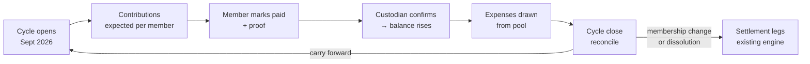

# Money Pooling — Functional Design

**Status:** Implemented on branch `feature/money-pooling` — read **§0** first for what changed from the proposal while building it. Testing guide: [MONEY_POOLING_TESTING.md](../runbook/MONEY_POOLING_TESTING.md).
- **Phase 1 enhancements built** on branch `feature/money-pooling-enhancements-phase1` (2026-10-25): a rejected spend already paid with the pool's money is owed back (**§9.2**), and money others add is paid back unless it's a gift (**§10**, Phase 1).
- **Phase 2 built** on branch `feature/money-pooling-enhancements-phase2` (2026-11-18), following [MONEY_POOLING_PHASE2_PLAN.md](MONEY_POOLING_PHASE2_PLAN.md):
  - handing money to spenders and tracking what they hold (**§9.3**);
  - paying lenders back early (**§10.6**);
  - netting repayments and unpaid claims into the final settlement (**§11**);
  - "Several of us" as a Pro feature, with every in-app Pro list updated (**§12**);
  - a free-trial eligibility check (§12.3).

  Phase 2 test plan: [MONEY_POOLING_PHASE2_E2E.md](../runbook/MONEY_POOLING_PHASE2_E2E.md).
- **Released with Phase 2, as a Pro feature (decided 2026-11-23):** the Phase 2 branch sets `CONTRIBUTOR_POOLS_IN_PRODUCTION = true`, with the web user guide, the Play Store text, the review notes and the RevenueCat descriptions updated. It reaches users when the Phase 2 web and app builds ship. The App Store text, the trial offers and the other console steps are in plan §11.
**Date:** 2026-09-15
**Scope:** Additive feature. The existing peer-to-peer split model remains fully supported and unchanged.

---

## 0. As built — where the implementation differs from this proposal

The proposal below is kept for context; these are the decisions that changed while building and testing it.

| Area | Proposal | As built | Why |
|---|---|---|---|
| **Fair shares** | Pro-rata to *confirmed* contributions | Weighted by **agreed commitment** (non-waived expected amounts): `net = opening + contributed − fairShare + cover` | Weighting by what was *paid* lets a non-payer escape their share. With commitment weights a member who paid nothing correctly owes their full share. Top-ups count as money in but don't enlarge a stake, so they're simply refunded. |
| **Overdraft pause (§3.7)** | "No latched state required — pre-flight is self-latching" | A **latch**: once the balance reaches the floor, pre-authorised draws stay refused until the balance rises **above** `clearance% × baseline` (default 0, i.e. the overdraft repaid *plus more*) | Pure pre-flight let a ₹500 top-up unblock a ₹500 spend. The requested rule was "block until 20% + additional amount is added". Reaching the floor latches by definition, so behaviour never depends on write timing. |
| **Reimbursement state** | `Expense.reimbursement` with paid/confirmed statuses | One `Expense.poolDraw` (`pending` / `approved` / `rejected`, plus `settlementId`, `alreadyIncurred`, `selfReimbursed`) for both pool spends and claims; payment progress is read from the linked settlement leg | One approval model for both kinds of draw; no state to keep in sync with the leg. |
| **Overdraft cover** | `isOverdraftCover: true` | `PoolContribution.kind: 'regular' \| 'top_up' \| 'overdraft_cover'` | Top-ups (to unpause, or to pay carried arrears) needed a kind too. |
| **Field names** | `targetAmount`, `receiptRequiredAbove`… | Integer minor units are explicit: `targetAmountMinor`, `expectedMinor`, `receivedMinor`… | Makes the unit impossible to misread. JPY has no minor unit, which `toMinor` handles. |
| **Cycle statuses** | `collecting \| open \| reconciling \| closed` | `open \| reconciling \| closed`; funding progress is *derived* (`PoolFundingState`) | Collection and spending happen concurrently; a stored status would drift. |
| **Club preset** | `collect_equal` | `collect_pro_rata` | Dues are tiered — a shortfall should be shared by tier, not head-count. |
| **Membership change** | Always forces a cycle boundary (UC-1) | Only once money has moved; in an untouched cycle the roster just updates. A member leaving a **group** doesn't settle the group. In single-cycle pools the roster only grows. | Avoids empty cycles while flatmates join; avoids retroactively refunding a kitty leaver who already consumed. |
| **Custodian's own dues** | Mark paid → confirm | Marking your own contribution paid as the custodian **confirms it at once** | The money is already in the custodian's hands (same rule as their top-ups). |
| **Settlement entry points** | Separate dissolve endpoint | `POST /api/pools/event/:id/dissolve` **and** the existing `POST /api/settlements/event/:id/generate` both reconcile the pool first | Otherwise the old "Settle now" button would compute peer debts only and mark a pool event settled with its money unaccounted for. |
| **Receipts** | New mobile camera dependency needed | `expo-image-picker` / `expo-file-system` were already dependencies | — |
| **Pro gating** | Consumption weighting as a Pro feature | Not gated | A product decision, left open. ("Several of us" pools as a whole became Pro in Phase 2, §12.) |

**Prerequisites delivered (Phase A):** `mock-` tokens refused outside local/test; event membership required to read **and create** expenses (others' private expenses hidden server-side); shared upload service (`POST /api/uploads`) with PDF receipts; receipts on every expense (web + mobile); CI on Node 24 running typecheck and all test suites.

**Not done:** the Firebase silent-mock-fallback in production (`config/firebase.ts`) and the IDOR on `GET /api/events/:id` were out of this plan's scope; see the code review for both.

### Phase 2 (built 2026-11-18): where it differs from §9.3, §10.6, §11 and §12

Decided while planning ([MONEY_POOLING_PHASE2_PLAN.md](MONEY_POOLING_PHASE2_PLAN.md) §1, approved 2026-11-16) or found while building (its §16).

| Area | Design | As built | Why |
|---|---|---|---|
| **"Asking first" (§9.3)** | Spends from held money or on the sponsor's card are always already paid | The Phase 1 choice stays under both methods. The **method** decides what a rejected, already-paid spend owes: held money stays owed (no leg); a card spend gets the Phase 1 repayment leg. Rejecting an "asking first" spend does nothing. | Otherwise an approved "asking first" spend paid with held cash would never lower what the spender holds. |
| **Getting money back (§9.3)** | Custodian action "Ask for money back" | **"Record money returned"** (mobile: **"Money returned"**): the custodian records cash received, confirmed at once. Spenders get **"Return money"**, which the custodian confirms. No request or notification. | Simpler; a request flow can come later. |
| **Who confirms** | Not specified | The receiver confirms. Whoever records a hand-over they're receiving is confirmed at once. Only the custodian records advances and early repayments. The recorder can cancel while it waits (status `cancelled`). | — |
| **Proof** | `proof?: Attachment[]` | One `proofUrl`, as on contributions (upload scope `pool_advance_proof`) | Reuses the existing upload and preview UI. |
| **Records** | `PoolAdvance` with kinds `advance` / `return` | One collection `poolAdvances` for kinds `advance`, `return` and `repayment` (early repayment, §10.6), with `cycleId`, `currency` and `rejectionReason`. `paidFrom` on the expense and `allowSponsorCardSpends` on the config as sketched. | One ledger and one set of routes (`/api/pools/event/:id/advances`, `/api/pools/advances/:id/confirm|reject|cancel`). |
| **Held money carried forward** | Not specified | A carry-forward close copies what each spender holds into the next cycle (`cycle.openingHeld`) | A rolling fund's cash doesn't reset each month. |
| **Early repayment limit** | Not specified | What the lender lent (confirmed top-ups that aren't gifts) less repayments confirmed or waiting. Overdraft cover isn't included; it's settled at close. | — |
| **Early repayment and the overdraft** | Not specified | Lowers the overdraft baseline and a collection's "funded" figure, as well as the balance | Repaid money is no longer funding. |
| **Leaving with held money** | Not specified | Refused (`POOL_HOLDER_LEAVING`) for someone counted on their own who holds money, is owed by the pool, or has a hand-over waiting. A rolling fund that closes on membership change puts it in their leaving settlement instead. Group members aren't checked: the group keeps the money. | Money mustn't vanish with a leaver. |
| **Membership change in a rolling fund** | Closes the cycle once money has moved | If a spend, top-up or hand-over is still waiting, the member list just updates and the cycle stays open | A waiting top-up used to make the close fail silently, so even the member list didn't change. |
| **Changing the custodian** | Not specified | Refused while spenders hold money or a hand-over is waiting (`POOL_CUSTODIAN_CHANGE_BLOCKED`) | The new custodian would inherit money they never held. |
| **Changing how a spend was paid** | Not specified | Re-runs approval like an amount change, and removes an unpaid repayment. Turning card spends off later doesn't block edits to card spends already recorded; only a newly chosen card method is refused (`POOL_CARD_SPENDS_OFF`). A spend without a method (older apps) is accepted. | The method decides what's owed if rejected. |
| **Notifications** | §11.5: show the netting breakdown | The expense-added notification names the payment method. **The netting breakdown isn't added** to notifications; the preview and the Review and Payment lists show it. | The fewest-payments plan doesn't map folded rows to single payments, so it would need per-person text. |
| **Netting order (§11.4)** | Mark rows after the plan is saved | The old plan is cleared and folded rows restored (one batch), this cycle's open rows marked `netted` (one transaction), then the plan is saved. A failed save leaves rows `netted`; the next run restores them first. | No debt is lost or doubled. |
| **Netted rows refused** | Not specified | Pay, mark paid, retry and close-for-deleted-user return **400** *"This payment is included in the final settlement"*. Audit actions `netted` and `unfolded`. | Same code as other settlement status errors. |
| **Regenerating during Review** | Not specified | Only the plan's own payments decide whose approvals reset | Every pool payment used to count, resetting approvals that hadn't changed. Split-expenses events are unchanged. |
| **Settle-up preview** | §11.4 step 5 | `folded` includes rows settle-up will create (approved claims, rejected card spends without a row yet); `separate` lists every other open pool payment. The preview waits for hand-overs to be confirmed. | — |
| **Pro check (§12)** | — | One shared check (`groupPoolRefusal`) for creating and converting. If the subscription lookup fails, the API returns a server error rather than "needs Pro". No exception for `mock-` users. | — |
| **Pro lists (§12.4)** | Add group pools | Group pools appear in every in-app Pro list only where "Several of us" is released (`contributorPoolsAvailable`), so turning the switch on stays the single release step. Web's lists also gain *Unlimited events* and *Analytics (coming soon)*, matching mobile. | Pro never advertises a feature before it ships. |
| **Free trial (§12.3)** | Not decided | A 7-day trial for new subscribers, offered only after the Phase 2 build is live. The app shows it on iOS only when RevenueCat says the account is eligible, and reads Google Play's trial from the default option ([plan §10A](MONEY_POOLING_PHASE2_PLAN.md)). | Apple gives an introductory offer once per subscription group. |
| **Next month's dues** | Per-member tiers (UC-4) | Closing a month gives each member the same dues as the month before; newcomers, and anyone whose dues were waived, get the default. Fixed 2026-11-23: until then, every month reset to the default, so a treasury lost its tiers at each close. | Found by the Phase 2 test plan's Scenario 7. |
| **Optional fields** | — | `earlyRepaymentsMinor` (left out when 0), `holdings`, `advances`, `heldMinor` and `UserCapabilities.contributorPools` are optional. A missing amount or list means none. A missing `contributorPools` means unknown: the apps lock "Several of us" only on an explicit `false`, and the API decides. | Older servers and existing data keep working. |

---

## 1. The core idea

Traxettle today is **expense-first, debt-derived**:

```
someone spends their own money → splits accrue → balances net out → settlement plan at the end
```

Money moves exactly once, at the end, peer-to-peer.

Money pooling is **fund-first, balance-drawn**:

```
money goes into a pool up front → expenses draw the pool down → reconcile surplus/deficit
```

The important realisation is that **these are not two different applications.** They are two *funding models* over the same expense ledger. A pool expense is still an expense — amount, currency, date, payer, receipt. What changes is only:

| | Peer-to-peer (today) | Pool (new) |
|---|---|---|
| Who funded it | an individual's own pocket | the pool |
| Does it create debt? | yes — that's the point | no — it reduces a balance |
| What does settlement mean? | net out mutual debts | return surplus / recover deficit |
| Are splits required? | yes | no (optional, for fairness weighting) |

So the design adds **a funding dimension**, rather than forking the data model. Concretely:

- `Event.fundingModel` — how this event is funded
- `Expense.fundingSource` — where *this* expense's money came from
- Two new ledger entities: `PoolCycle` and `PoolContribution`

Everything else — groups as entities, the greedy settlement engine, the pay → confirm → proof → audit flow, event lifecycle locks — is reused as-is.

### The design decision that makes this cheap

`PoolEntityShare.net` (what each contributor is owed or owes after reconciliation) has **exactly the same semantics** as the existing `Balance.amount`: positive = owed money, negative = owes money.

And `calculateSettlementPlan()` in `apps/api/src/services/settlement.service.ts:333` is already a **pure function** over `Balance[]`:

```ts
calculateSettlementPlan(balances: Balance[], eventId: string, currency: string, groups: Group[] = []): SettlementPlan
```

So pool reconciliation converts its result into `Balance[]` and feeds the **existing, already-tested settlement engine**. We get transaction-minimised refund/top-up legs, the payer-marks-paid → payee-confirms flow, proof upload, audit trail, and auto-settle **for free**.

> **No new settlement algorithm. No new payment rails. No new payment UI.**

---

## 2. Use cases

The two you described, plus four more that have genuinely *different workflows* (not just different flavour).

### UC-1 — Recurring shared-living pool *(yours)*

Flatmates contribute a pre-agreed amount monthly; rent, electricity, internet, groceries are paid from the pool.

**Distinctive workflow needs:** recurring contribution cycles · carry-forward balance between months · arrears tracking (who hasn't paid this month) · receipts for transparency · reconciliation on *membership change*, not just at the end.

**Settlement trigger:** cycle close is a *bookkeeping* event (carry the balance forward, no money moves). Real settlement happens on member join/leave or dissolution.

### UC-2 — Single-sponsor budgeted event *(yours)*

You budget ₹8,00,000 for a wedding. There are **no contributors** — but there are **multiple spenders**: one group does shopping, another does venue/planning.

**Distinctive workflow needs:** budget vs. actual tracking · authorised spenders who are *not* contributors · reimbursement claims with mandatory receipts · per-spender spend visibility · hard or soft budget stop.

**Settlement trigger:** there is **no inter-participant settlement at all.** "Settlement" here means: every spender has been reimbursed, and the remaining budget is reported back to you.

### UC-3 — Trip kitty / float *(new)*

Everyone drops ₹10,000 into a kitty before a trip. One person holds the cash or card. At the end, surplus is refunded or a deficit topped up.

**Why it's distinct from UC-1:** single cycle, not recurring. **From UC-2:** multiple contributors who each expect a refund.

**The subtle part:** refunds must be **pro-rata to contribution**, not equal. If A put in ₹15,000 and B put in ₹5,000 and ₹4,000 is left, A gets ₹3,000 and B gets ₹1,000. Refunding equally is a silent unfairness bug.

**This is the highest-volume case for Traxettle's existing trip audience** and the easiest adoption path — it is literally the same trip event, funded differently.

### UC-4 — Club / team treasury *(new)*

A running club collects monthly dues at **unequal tiers** (full ₹500 / student ₹200 / patron ₹2,000) and pays for track hire, kit, events.

**Why it's distinct from UC-1:** contributions are *dues*, not shares of a known cost. Nobody expects a refund — **surplus carries forward indefinitely as a treasury**, and "settlement" is replaced by **periodic transparency reporting**. Membership churns constantly without triggering reconciliation.

**Needs:** per-member contribution tiers · perpetual carry-forward · published ledger · no dissolution flow.

### UC-5 — Target-based collection / advance escrow *(new)*

"I'm booking the villa — everyone send ₹8,000 by Friday."

Money is collected against a **known upcoming expense**, not a general budget.

**Distinctive workflow:** the pool has a **target amount** and a funding state — `underfunded → funded → spent → reconciled`. The expense is pre-declared before the money arrives. The organiser needs to know *"am I clear to book?"*

**Needs:** funding progress toward a target · due dates and chase-ups · block-or-warn on spending while underfunded.

### UC-6 — Hybrid: pool *and* peer-to-peer in one event *(new — and an architectural requirement)*

The villa, the van hire and the groceries come out of a shared kitty. Someone's spa afternoon and Tuesday's bar round stay as ordinary peer-to-peer splits. **Same event.**

This is less a use case than **the most important constraint on the design**: the two models must coexist inside a single event, which is why funding source belongs on the **expense**, not just the event.

It also unifies UC-1 and UC-2: "I paid the electricity bill with my own card and want it back from the pool" (UC-1) and "the shopping group spent their own money and needs reimbursing" (UC-2) are the **same operation** — a reimbursement claim against the pool.

---

## 3. Data model

All new fields are **optional**, and absent fields must read as the current behaviour. Every existing Firestore document lacks these fields, so this is non-negotiable:

```ts
const model = event.fundingModel ?? 'peer_to_peer';   // existing events keep working
const source = expense.fundingSource ?? 'self';
```

### 3.1 Event

```ts
export type EventFundingModel = 'peer_to_peer' | 'pool' | 'hybrid';

export interface Event {
  // ... all existing fields unchanged ...
  /** Absent ⇒ 'peer_to_peer'. Never write this field on existing events. */
  fundingModel?: EventFundingModel;
  poolConfig?: PoolConfig;
}

export type PoolCycleMode = 'single' | 'recurring';

export interface PoolConfig {
  cycleMode: PoolCycleMode;
  recurrence?: 'monthly' | 'quarterly' | 'custom';

  /** UC-2 budget / UC-5 collection target. null ⇒ open-ended. */
  targetAmount?: number | null;

  /** Who physically holds the money. Confirms contributions, approves draws. */
  custodianUserId: string;

  /** UC-2: may spend from the pool without contributing to it. */
  authorizedSpenders?: string[];

  surplusPolicy: 'refund_pro_rata' | 'refund_equal' | 'carry_forward' | 'retain';
  deficitPolicy: 'collect_pro_rata' | 'collect_equal' | 'collect_by_consumption' | 'custodian_absorbs';

  /** Receipt mandatory on pool draws above this. 0 ⇒ always. null ⇒ never. */
  receiptRequiredAbove?: number | null;

  expenseApproval: 'none' | 'above_threshold' | 'always';
  approvalThreshold?: number | null;

  /** See §3.7. 'graduated' is the default. */
  overdraftPolicy: 'block' | 'graduated' | 'allow';
  /** 'graduated': % of baseline that may be overdrawn before draws are refused. Default 20. */
  overdraftTolerancePercent?: number;
  /** How the baseline is derived. Default 'confirmed_funding'. */
  overdraftBaseline?: 'confirmed_funding' | 'expected_funding' | 'target_amount';
  /** Optional hysteresis — must recover to this % of baseline before draws resume. Default 0. */
  overdraftClearancePercent?: number;
}
```

**Default policy per use case:**

| Use case | `cycleMode` | `surplusPolicy` | `deficitPolicy` | `overdraftPolicy` |
|---|---|---|---|---|
| UC-1 household | `recurring` | `carry_forward` | `collect_pro_rata` | `graduated` 20% |
| UC-2 sponsor budget | `single` | `retain` | `custodian_absorbs` | `graduated` 20% * |
| UC-3 trip kitty | `single` | `refund_pro_rata` | `collect_pro_rata` | `graduated` 20% |
| UC-4 club treasury | `recurring` | `carry_forward` | `collect_equal` | `graduated` 20% |
| UC-5 escrow | `single` | `refund_pro_rata` | `collect_pro_rata` | `block` |

\* *UC-2 may prefer `block` for a hard budget cap; UC-5 keeps `block` because the whole point is "don't commit until the money is in."*

These become the presets behind the UI, so nobody has to understand the policy matrix to create a pool.

### 3.2 PoolCycle — the accounting period

```ts
export interface PoolCycle {
  id: string;
  eventId: string;
  sequence: number;                 // 1, 2, 3...
  label: string;                    // "September 2026"
  startDate: Date;
  endDate?: Date;
  status: 'collecting' | 'open' | 'reconciling' | 'closed';

  /** Carried in from the previous cycle. 0 for cycle 1. */
  openingBalance: number;
  expectedContributionTotal: number;
  confirmedContributionTotal: number;
  poolSpendTotal: number;
  approvedReimbursementTotal: number;
  /** opening + confirmed − spend − reimbursements */
  closingBalance: number;
  currency: string;

  /** Why this cycle ended — matters for UC-1 membership changes. */
  closeReason?: 'scheduled' | 'membership_change' | 'dissolution' | 'manual';
  reconciliation?: PoolReconciliation;
  createdAt: Date;
  updatedAt: Date;
}
```

Single-cycle pools (UC-2, UC-3, UC-5) simply have exactly one cycle. **One code path serves both recurring and one-shot pools** — this is a deliberate complexity reduction.

### 3.3 PoolContribution — the money-in ledger

Deliberately shaped to **mirror `Settlement`**, so the existing mark-paid → confirm interaction, the proof uploader, and the audit trail all transfer directly.

```ts
export interface PoolContribution {
  id: string;
  eventId: string;
  cycleId: string;

  fromEntityId: string;
  fromEntityType: 'user' | 'group';   // reuses the existing entity model
  fromUserId: string;                 // for groups, the group's payer

  expectedAmount: number;
  receivedAmount: number;             // supports partial payment
  currency: string;

  status: 'pending' | 'initiated' | 'partial' | 'confirmed' | 'waived' | 'rejected';
  dueDate?: Date;

  // ---- identical in shape to Settlement from here down ----
  paymentReference?: string;
  payerNote?: string;
  proofUrl?: string;
  payerMarkedAt?: Date;
  custodianConfirmedAt?: Date;
  rejectionReason?: string;
  auditTrail?: SettlementAuditEntry[];   // reuse the existing shared type
  createdAt: Date;
  updatedAt: Date;
}
```

`'partial'` exists because real people underpay. `'waived'` covers *"he's covering it next month."* Both were learned omissions in every pool product.

### 3.4 Expense — the funding dimension

```ts
export type ExpenseFundingSource = 'self' | 'pool' | 'pool_reimbursement';

export interface Expense {
  // ... all existing fields unchanged ...
  /** Absent ⇒ 'self'. Existing expenses keep working. */
  fundingSource?: ExpenseFundingSource;
  poolCycleId?: string;
  reimbursement?: ReimbursementState;
}

export interface ReimbursementState {
  claimantUserId: string;
  status: 'claimed' | 'approved' | 'paid' | 'confirmed' | 'rejected';
  approvedBy?: string;
  approvedAt?: Date;
  /** The Settlement leg created to pay the claimant back. */
  settlementId?: string;
  rejectionReason?: string;
}
```

The three funding sources are the heart of the design:

| `fundingSource` | Meaning | Splits? | Creates debt? | Effect on pool |
|---|---|---|---|---|
| `self` | **Today's behaviour, untouched** | required | yes | none |
| `pool` | Paid directly from pool funds | optional* | no | deducts |
| `pool_reimbursement` | Spender used own money, claims it back | optional* | no | deducts + creates a payable to the spender |

\* *Splits on a pool expense are optional and used only for `collect_by_consumption` deficit weighting — see §4.6.*

A reimbursement **terminates in a `Settlement`**. That is what lets us pay spenders back using the entire existing payment machinery without writing any of it again.

### 3.5 Reconciliation

```ts
export interface PoolReconciliation {
  cycleId: string;
  openingBalance: number;
  confirmedContributions: number;
  poolSpend: number;
  approvedReimbursements: number;
  /** > 0 surplus · < 0 deficit */
  closingBalance: number;
  outcome: 'surplus' | 'deficit' | 'balanced';
  entityShares: PoolEntityShare[];
  /** Settlement legs generated to resolve it (empty for carry_forward). */
  settlementIds: string[];
  generatedAt: Date;
  generatedBy: string;
}

export interface PoolEntityShare {
  entityId: string;
  entityType: 'user' | 'group';
  contributed: number;
  /** Fair share of spend under the active policy. */
  fairShare: number;
  /** contributed − fairShare.  > 0 ⇒ owed a refund · < 0 ⇒ owes more */
  net: number;
}
```

`PoolEntityShare[]` → `Balance[]` is a one-line map, and then the existing settlement engine takes over.

### 3.6 Money precision — fix this before building

The existing code carries money as **floats** with `Math.round(x * 100) / 100` scattered throughout (`settlement.service.ts:299`, `:362`, `:381-382`). That is tolerable for splitting one dinner bill.

It is **not** tolerable for a pool: a running balance carried across twelve monthly cycles accumulates float drift, and the ledger stops reconciling to zero. You will notice this around month four and lose a day finding it.

**Recommendation:** store all pool amounts as **integer minor units** (paise/cents) in `PoolCycle`, `PoolContribution` and `PoolReconciliation`, converting only at the presentation boundary. Keep `Expense.amount` as-is for compatibility and convert on read into the pool ledger.

### 3.7 Graduated overdraft

Spending past the pool balance is **allowed with a warning up to 20% of the pool's value, then refused** until money is added.

#### Definitions

```
baseline  B = the pool's value for this cycle (see below)
tolerance T = floor(B × overdraftTolerancePercent / 100)      // default 20%
floor       = −T                                              // hard limit
balance     = cycle.closingBalance                            // derived, may be negative
```

**Baseline** depends on how the pool is funded:

| `overdraftBaseline` | Value | Use |
|---|---|---|
| `confirmed_funding` **(default)** | `openingBalance + confirmedContributionTotal` | UC-1, 3, 4 — headroom grows as money actually arrives |
| `expected_funding` | `openingBalance + expectedContributionTotal` | when the roster is reliable and you want stable headroom despite late payers |
| `target_amount` | `poolConfig.targetAmount` | UC-2, UC-5 — the declared budget is the reference |

The default is deliberately the **prudent** one: if nobody has paid yet, `B = 0`, so `T = 0` and the pool behaves as `block`. The formula degrades safely at the edges with no special-casing.

#### The check is pre-flight, and that is all the enforcement needed

```ts
function assertDrawAllowed(cycle, config, amount, opts: { alreadyIncurred: boolean }) {
  const { balance, floor } = computeOverdraftState(cycle, config);
  const projected = balance - amount;

  if (config.overdraftPolicy === 'allow') return { ok: true, warn: projected < 0 };
  if (config.overdraftPolicy === 'block') {
    return projected < 0 ? refuse('POOL_INSUFFICIENT_FUNDS') : { ok: true };
  }

  // graduated
  if (projected < floor) {
    // Money that has already left someone's account must be recorded even if it
    // breaches the limit — an accurate ledger beats an enforced one. Flag instead.
    if (opts.alreadyIncurred) return { ok: true, flagged: 'exceeds_tolerance' };
    return refuse('POOL_OVERDRAFT_BLOCKED');
  }
  return { ok: true, warn: projected < 0 };
}
```

**The pause is latched** *(changed while building — see §0)*. Reaching the floor pauses pre-authorised spending, and it stays paused until the balance rises **above** the clearance threshold (default 0 ⇒ the full overdraft repaid *plus more*). A partial top-up does not unpause it, so ₹500 in can't unlock a ₹500 spend. The latch is also implied whenever `balance ≤ floor`, so behaviour never depends on when the flag was written. Release is automatic once confirmed money lifts the balance.

Set `overdraftClearancePercent > 0` only if you want to prevent **dribbling** (top up ₹500, spend ₹500, blocked again). At `10`, the balance must recover to `+10% of B` before any draw is permitted. Default `0`.

Only **confirmed** contributions move the balance. A member marking themselves paid does not unblock the pool; the custodian confirming receipt does. This reuses the existing two-sided confirmation.

#### Pre-authorisation vs. recording — the distinction that matters

| Situation | Behaviour |
|---|---|
| *"I'm about to spend from the pool card"* — `fundingSource: 'pool'`, not yet incurred | **Refuse** past the floor. A limit that a single large expense can blow through is not a limit. |
| *"I already paid the electricity bill"* — `pool_reimbursement`, or a pool draw being recorded after the fact | **Record, flag, notify the custodian.** Refusing to record real money that already moved makes the ledger wrong, which is worse than an overdraft. |

Enforcement points: `POST /api/expenses` (when `fundingSource === 'pool'`), `POST /api/pools/expenses/:id/approve`, and `POST /api/pools/expenses/:id/approve-claim` — **approval** is what deducts, so a custodian sees *"approving this pushes the pool ₹3,000 past its limit"* before clicking.

#### Worked example — UC-1 household

```
opening balance                    ₹  8,400
confirmed contributions            ₹ 45,000
──────────────────────────────────────────
baseline  B                        ₹ 53,400
tolerance T = 20% of B             ₹ 10,680
floor                              ₹−10,680   → total spend permitted ₹64,080 (120% of B)

spent so far                       ₹ 58,000
balance                            ₹ −4,600   ⚠ overdrawn, ₹6,080 of headroom left

→ ₹4,000 repair bill   projected −₹8,600   ✅ allowed, warned
→ ₹9,000 repair bill   projected −₹13,600  ⛔ refused (needs ₹2,920 more in the pool)

Dev pays his ₹15,000 → B becomes ₹68,400, T becomes ₹13,680, balance +₹10,400
→ pool healthy again, no manual unblock step
```

Note the floor **moves with the baseline**: more money in means more headroom. That is intentional, and the UI must show it live rather than caching it.

#### Consequence at reconciliation — attributing who covered the overdraft

A negative closing balance means **someone's real money covered the gap** — normally the custodian's card. If that is not recorded, reconciliation charges them a share of spend they personally financed.

**Resolution:** at cycle close, a negative balance prompts *"the pool closed ₹6,600 short — who covered it?"* (default: custodian, re-attributable or splittable). That creates an implicit `PoolContribution` with `status: 'confirmed'` and `kind: 'overdraft_cover'`.

Everything then follows automatically: `confirmedContributionTotal` absorbs it, the closing balance resolves to zero so the ledger invariants hold, the coverer's `PoolEntityShare.contributed` includes it, and they come out with `net > 0` — owed a refund for whatever they fronted beyond their fair share. No special case in the settlement path.

### 3.8 Invariants worth asserting in code

These are cheap to test and they are what makes a ledger trustworthy:

1. `closingBalance === openingBalance + confirmedContributions − poolSpend − approvedReimbursements`
2. `Σ entityShares[].net === closingBalance` for all refund/collect policies
3. `Σ entityShares[].fairShare === poolSpend + approvedReimbursements`
4. `nextCycle.openingBalance === previousCycle.closingBalance`
5. A reimbursement's amount never exceeds its expense amount
6. No pool expense may be written against a cycle in `closed` status
7. Under `overdraftPolicy: 'block'`, no draw may take `closingBalance` negative
8. Under `'graduated'`, no **pre-authorised** draw may take `closingBalance` below `floor`; after-the-fact records may breach it but must carry `flagged: 'exceeds_tolerance'`
9. A cycle may not reach `closed` with a negative `closingBalance` **and** no `overdraft_cover` contribution — the gap must be attributed to someone

---

## 4. Functional workflows

The pipeline you asked for — **pool → expenditure → transaction reporting → deduction → settlement** — instantiated per use case.

### 4.1 UC-1 — Recurring shared-living pool



**1 · Pool setup.** Admin creates the event with `fundingModel: 'pool'`, `cycleMode: 'recurring'`, `recurrence: 'monthly'`, names a custodian, sets `surplusPolicy: 'carry_forward'`. Cycle 1 opens with `openingBalance: 0`.

**2 · Contribution collection.** Admin sets the expected amount per member — flat (₹15,000 each) or per-member. This generates one `PoolContribution` per member with `status: 'pending'` and a due date.

Each member pays *outside the app* (UPI, bank transfer — same as today's settlement model), then **marks paid** with an optional reference and receipt image. The custodian **confirms receipt**, which is the only action that moves `confirmedContributionTotal`. Partial payment sets `status: 'partial'` and records `receivedAmount`.

> This is the same two-sided confirmation already implemented for settlements. The proof uploader at `settlements.ts:181` generalises to serve it.

**3 · Expenditure.** Electricity bill of ₹4,200 is added as an expense with `fundingSource: 'pool'`. No splits are required. If `receiptRequiredAbove` is met, the receipt is mandatory. If `expenseApproval` is configured, the draw sits in a pending state until the custodian approves.

When a flatmate pays the internet bill with their own card, they add it with `fundingSource: 'pool_reimbursement'` — a claim. Custodian approves → a `Settlement` leg is created paying them back from the pool.

**4 · Transaction reporting.** The **Pool** tab is the transparency surface, and this is the feature that actually sells UC-1:

- Cycle header: *opening ₹8,400 · collected ₹45,000 · spent ₹38,900 · **remaining ₹14,500***
- Contribution roster with per-member status chips and **arrears highlighted**
- Chronological ledger: every contribution in, every expense out, each with who, when, and a receipt thumbnail
- Cycle history with closing balances
- CSV/PDF export (the web app already has export utilities at `apps/web/src/utils/closed-events-export.ts`)

**5 · Amount deduction.** `closingBalance` is **always derived**, never stored as a mutable running total — recomputed from confirmed contributions and recorded spend. This means a corrected or deleted expense self-heals the balance instead of leaving the ledger wrong.

**6 · Settlement.** Two distinct triggers, and separating them is what makes recurring pools work:

- **Scheduled cycle close** — reconcile, carry `closingBalance` into the next cycle's `openingBalance`, open the next cycle. Event stays `active`. **No money moves. No settlement legs.** This is bookkeeping.
- **Membership change** — a member joining or leaving **forces a cycle boundary**: close the current cycle early (`closeReason: 'membership_change'`), reconcile among the *then-current* roster, carry the balance forward, open a new cycle with the new roster. This is the honest answer to *"new members add or are removed, to start all over again."*
- **Dissolution** — final reconcile under `surplusPolicy`/`deficitPolicy`, generate settlement legs via the existing engine, and walk the **existing** event lifecycle: `active → review → payment → settled → closed`.

### 4.2 UC-2 — Single-sponsor budgeted event

**1 · Pool setup.** `fundingModel: 'pool'`, `cycleMode: 'single'`, `targetAmount: 800000`, custodian = you, `surplusPolicy: 'retain'`, `deficitPolicy: 'custodian_absorbs'`, `overdraftPolicy: 'block'`.

**No contribution roster is created** — you are the sole funder. A single self-contribution of ₹8,00,000 is recorded, `status: 'confirmed'`, to open the balance.

**2 · Authorise spenders.** You add the shopping group and the planning group as `authorizedSpenders` — optionally with per-spender caps. Note these people are **not contributors and not split participants**; the existing `Group` model carries them, so group-level authorisation works without new structure.

**3 · Expenditure — two paths.**

- **Direct pool spend** — spender has the pool card or cash. `fundingSource: 'pool'`, receipt required. Deducts immediately on approval. *(Rejecting one that was already paid with the sponsor's money creates a repayment leg back to the sponsor, §9.2. The handover of cash or card isn't recorded yet, §9.3.)*
- **Others adding money** — a spender who tops up the pool is lending to the event; the sponsor pays it back at close unless it was a gift (§10).
- **Spend-then-reimburse** — the common case. Spender uses their own money, adds the expense with `fundingSource: 'pool_reimbursement'` and **a mandatory receipt**. State machine:

```
claimed → approved → paid → confirmed
              ↘ rejected (with reason)
```

On `approved`, a `Settlement` leg is created from you to the claimant. You pay it and they confirm receipt — the existing pay/confirm flow, unchanged. Only `approved` reimbursements deduct from the pool.

**4 · Transaction reporting.** Budget-oriented rather than contribution-oriented:

- **Budget meter:** ₹8,00,000 budgeted · ₹5,40,000 committed · **₹2,60,000 remaining**
- Spend **by spender/group** — who has spent how much, against their cap
- Pending reimbursement queue with receipt thumbnails, one-tap approve/reject
- Category breakdown once expense categories exist (not built today)

**5 · Amount deduction.** Under `overdraftPolicy: 'block'`, a draw that would exceed the remaining budget is **rejected at the API** with a clear error — not merely warned in the UI. Reimbursement claims are held against `closingBalance` at approval time, not at claim time.

**6 · Settlement.** There is **no inter-participant settlement**. Completion means: every approved reimbursement is `confirmed`, no claims are outstanding, and you get a final report — *budgeted ₹8,00,000, spent ₹7,42,300, unspent ₹57,700.* The event then goes straight to `settled → closed`, skipping `review` (there are no counterparties to approve anything).

### 4.3 UC-3 — Trip kitty

Setup identical to UC-1 but `cycleMode: 'single'` and `surplusPolicy: 'refund_pro_rata'`.

The one thing to get right is the refund maths. With ₹4,000 left after A contributed ₹15,000 and B ₹5,000:

```
fairShare(A) = poolSpend × (15000 / 20000) = 0.75 × spend
fairShare(B) = poolSpend × (5000 / 20000)  = 0.25 × spend
net(A) = 15000 − fairShare(A) = +3000    → refund ₹3,000
net(B) =  5000 − fairShare(B) = +1000    → refund ₹1,000
```

Those two `net` values become `Balance[]`, go into `calculateSettlementPlan()`, and come out as minimal refund legs the custodian pays through the existing flow.

**Refunding equally here would be a silent unfairness bug** — worth an explicit test.

### 4.4 UC-4 — Club treasury

UC-1's machinery with three differences:

- Contribution amounts are **per-member tiers**, set on the roster rather than one flat figure
- `surplusPolicy: 'carry_forward'` **permanently** — there is no dissolution flow, and the UI should not offer one
- Membership churn does **not** force a cycle boundary (unlike UC-1) — members join and leave without reconciliation, because nobody expects a refund

"Settlement" is replaced entirely by the **published ledger**: a per-cycle report the treasurer can export and circulate.

### 4.5 UC-5 — Target-based collection

Adds a **funding-state gate** ahead of spending:

```
underfunded ──(confirmed ≥ target)──> funded ──> spent ──> reconciled
```

- The pool declares `targetAmount` and its intended expense up front
- The Pool tab leads with **progress toward the target** and a chase-up list of who hasn't paid, with due dates
- Under `overdraftPolicy: 'block'`, spending is refused while `underfunded` — which answers the organiser's real question: *"am I clear to book the villa?"*
- Once spent, reconciliation is UC-3's pro-rata refund

### 4.6 UC-6 — Hybrid, and the fairness interlock

With `fundingModel: 'hybrid'`, one event carries both kinds of expense. The **Expenses** tab shows both, badged by funding source. At reconciliation the two streams are computed independently and then merged:

1. Peer-to-peer expenses → existing `calculateBalances()` → `Balance[]`
2. Pool reconciliation → `PoolEntityShare[]` → `Balance[]`
3. **Sum the two `Balance[]` arrays per entity**, then run `calculateSettlementPlan()` **once**

The result is a single minimal set of payments covering both models — which is strictly better than making people settle twice, and requires no change to the engine.

**The consumption-weighting interlock.** When a pool runs dry, who covers the shortfall? `deficitPolicy` decides:

- `collect_pro_rata` — weighted by what each person contributed
- `collect_equal` — split evenly
- `collect_by_consumption` — **weighted by what each person actually consumed**, which requires pool expenses to carry splits

That last option is where pool mode and the existing split engine genuinely interlock: the flatmate who was travelling for two weeks can argue their share of groceries was smaller. It is optional per expense, adds real fairness, and is a natural **Pro-tier** differentiator alongside `multiCurrencySettlement`.

---

## 5. API surface

A new `apps/api/src/routes/pools.ts` router (~15 endpoints against the existing 81). No existing endpoint changes signature; several gain optional behaviour.

```
# Reading (any participant)
GET    /api/pools/event/:eventId/summary?cycleId=     derived balance, overdraft, funding, arrears
GET    /api/pools/event/:eventId/ledger?cycleId=      summary + contributions + entries + spenders + cycles
GET    /api/pools/event/:eventId/cycles               cycle history

# Settings (admins)
PUT    /api/pools/event/:eventId/config               policies, custodian, spenders, caps (funding shape fixed)
POST   /api/pools/event/:eventId/convert              add a pool to a split-expenses event (→ hybrid)

# Contributions
PUT    /api/pools/event/:eventId/contributions        set expected amounts per entity (custodian/admin)
POST   /api/pools/event/:eventId/top-ups              ad-hoc money in (self-confirmed for the custodian)
POST   /api/pools/contributions/:id/mark-paid         contributor (custodian's own: confirmed at once)
POST   /api/pools/contributions/:id/confirm           custodian
POST   /api/pools/contributions/:id/reject            custodian → back to pending/partial
POST   /api/pools/contributions/:id/waive             custodian/admin

# Draws (pool expenses are created through POST /api/expenses with fundingSource)
POST   /api/pools/expenses/:expenseId/approve         → a claim gets a reimbursement settlement leg
POST   /api/pools/expenses/:expenseId/reject

# Close & settle up
POST   /api/pools/event/:eventId/close-preview        reconcile without committing (+ coverNeededMinor)
POST   /api/pools/event/:eventId/close                commit; carry forward or pay out; open next cycle
POST   /api/pools/event/:eventId/dissolve             final reconcile → existing review → payment → settled

# Files
POST   /api/uploads                                    { scope: expense_receipt | pool_contribution_proof }
```

**Reuse notes**

- `POST /:settlementId/upload-proof` (`settlements.ts:181`) is a complete, working image pipeline — base64 → MIME allowlist → 5 MB cap → Firebase Storage → signed URL, with emulator handling. **Generalise it** into a shared uploader keyed by `(scope, scopeId)` so contributions, receipts and settlement proofs all share one path.
- `Expense.attachments: string[]` **already exists and already persists** (`expense.service.ts:28, 65, 92, 127`) — no UI writes to it. Receipts are load-bearing for UC-1 and UC-2, so wiring this up is a small job for a large functional gain.
- `SettlementAuditEntry` is reused verbatim for contribution audit trails.
- `event-guards.ts` needs **no change**: `requireEditableEvent` blocking mutations during `payment`/`settled`/`closed` is exactly right for pool mode too.
- `settlementApprovals` on `Event` already implements per-entity approval of a proposed settlement — reuse it for approving a **reconciliation** before refunds go out.

**Overdraft refusals** follow the structured-error pattern already used by `FEATURE_REQUIRES_PRO` (`entitlement.service.ts:66-70`), so clients can render the amber/red states without re-deriving anything:

```jsonc
{
  "success": false,
  "error": "Pool spending is paused",
  "code": "POOL_OVERDRAFT_BLOCKED",
  "data": {
    "balance": -1068000,        // all amounts in minor units
    "baseline": 5340000,
    "tolerance": 1068000,
    "floor": -1068000,
    "requested": 900000,
    "projected": -1968000,
    "shortfall": 900000,        // add this much to permit THIS draw
    "clearanceRequired": 1068000 // add this much to leave the blocked state
  }
}
```

**Validation.** This is where the unused `zod` dependency (declared in `apps/api/package.json`, currently **zero usages**) should finally earn its place. Pool endpoints do money-in/money-out arithmetic against a shared ledger; a malformed payload here corrupts other people's financial records, not just the sender's. Schema-validate every pool write.

---

## 6. User interface

The goal: a user in the current model should notice **nothing**, and a pool user should not have to understand the word "funding model."

### 6.1 Mode is chosen at creation, not toggled at runtime

**Recommendation:** pick the funding model when the event is created. Offer a deliberate one-way **peer-to-peer → pool** conversion later, but never an ambient toggle.

Rationale: a runtime toggle doubles every branch in a page that is already 2,347 lines with 41 `useState` calls (`apps/web/src/app/events/[eventId]/page.tsx`). Creation-time choice lets each mode render its own tab set and keeps the blast radius small.

### 6.2 Create event — a funding step

The form already has a `Type` select and conditionally-revealed FX blocks, so this fits the established pattern. Two questions, presented as **cards rather than a dropdown** because the choice is consequential:

**Q1 — How is this event funded?**

| | |
|---|---|
| **Split expenses** *(default)* | "Everyone pays their own way. Settle up at the end." → today's behaviour exactly |
| **Pool money** | "Collect money up front. Spend from the pool." |

**Q2 — appears only if Pool — Who puts money in?**

| | |
|---|---|
| **Several of us** | → contribution roster UI appears (UC-1, 3, 4, 5). **Pro** (§12): a free user sees a PRO badge and a link to upgrade |
| **Just me** | → no roster; budget + spender authorisation UI instead (UC-2) |

Then a single follow-up, `Recurring?` — *One-off* vs *Monthly* — which selects between the policy presets in §3.2. **The user never sees `surplusPolicy` or `deficitPolicy`**; presets set them, and an "Advanced" disclosure exposes them for people who care.

### 6.3 Event detail — adaptive tabs

Current tabs (`page.tsx:1593-1602`): `Expenses · Participants · Groups · Invitations`

| Mode | Tabs |
|---|---|
| **Peer-to-peer** | `Expenses · Participants · Groups · Invitations` — **unchanged** |
| **Pool, multi-contributor** | **`Pool`** · `Expenses · Participants · Groups · Invitations` |
| **Pool, single sponsor** | **`Pool`** · `Expenses` · **`Spenders`** |

In single-sponsor mode, `Participants`/`Groups`/`Invitations` **collapse into `Spenders`** — because there is no splitting. You are authorising people to spend, not splitting with them. Keeping three irrelevant tabs would be the single most confusing thing we could ship for UC-2.

**The `Pool` tab** is the centrepiece and the main new surface:

```
┌─────────────────────────────────────────────────────┐
│  September 2026            [Close cycle ▾]          │
│  ████████████████████░░░░░░░░░░   ₹14,500 left      │
│  opened 8,400 · collected 45,000 · spent 38,900     │
├─────────────────────────────────────────────────────┤
│  ⚠ OVERDRAWN  (amber state — see §6.3a)             │
│  ███████████████████████████▓▓▓▓│          −₹4,600  │
│                      pool 53,400 ╌╌ limit 64,080    │
│  ₹6,080 of overdraft headroom left                  │
├─────────────────────────────────────────────────────┤
│  CONTRIBUTIONS                     45,000 / 60,000  │
│  ● Asha      15,000   confirmed        [receipt]    │
│  ● Ravi      15,000   confirmed        [receipt]    │
│  ◐ Meera      7,500   partial          [remind]     │
│  ○ Dev            —   overdue 4d       [remind]     │
├─────────────────────────────────────────────────────┤
│  LEDGER                              [Export ▾]     │
│  02 Sep  + 15,000  Asha contribution     [receipt]  │
│  05 Sep  −  4,200  Electricity           [receipt]  │
│  08 Sep  −  2,100  Internet (Ravi, reimb)[receipt]  │
├─────────────────────────────────────────────────────┤
│  CYCLE HISTORY                                      │
│  Aug 2026   closed   +8,400 carried forward         │
└─────────────────────────────────────────────────────┘
```

In single-sponsor mode the same tab leads with a **budget meter** and *spend by spender* instead of a contribution roster.

### 6.3a The balance meter has three zones

The meter must make the graduated overdraft legible at a glance, because "you have ₹6,080 of headroom left" is a different message from "you have ₹6,080 left."

| Zone | Condition | Treatment |
|---|---|---|
| **Healthy** | `balance > 0` | Green fill. *"₹14,500 left of ₹53,400."* |
| **Overdrawn** | `floor < balance ≤ 0` | Fill continues past the 100% mark into a **hatched amber** region ending at a dashed limit line. *"Overdrawn ₹4,600 · ₹6,080 of headroom left."* Custodian gets a notification on first entry. |
| **Blocked** | `balance ≤ floor` | Red. *"Pool spending is paused — add ₹4,600 to resume."* New pool expenses are disabled at the UI **and** refused at the API. |

Three details that matter:

- The limit line **moves** as contributions arrive. Recompute from the current cycle; never cache the floor client-side.
- In the blocked state, **"Record an expense I already paid" stays available** — it routes to the after-the-fact path (§3.7), records, and flags. Only pre-authorised draws are disabled.
- The blocked empty state should link straight to *chase contributions* (who is in arrears) rather than being a dead end, since that is the actual remedy.

The same three zones drive the dashboard tile chip: green balance, amber *"overdrawn"*, red *"paused."*

### 6.4 Create expense — the pivotal screen

This is where the two models actually meet, and getting it right is what keeps pool mode from feeling like bolted-on complexity.

Add a **"Paid with"** control at the **very top** of the form — before splits — because it determines what the rest of the form even looks like:

| Choice | Form behaviour |
|---|---|
| **Pool funds** | **Hides the entire split section.** Shows live remaining balance. Receipt field, required above threshold. |
| **My own money → claim from pool** | **Hides splits.** Receipt **required**. Confirms *"you'll be reimbursed ₹4,200."* |
| **My own money → split with participants** | **The existing form, completely unchanged** — this is how hybrid mode works |

The key UX property: choosing a pool option **removes** UI rather than adding it. Logging a pool expense is *fewer* decisions than today — amount, title, receipt, done. No split type, no entity selection, no on-behalf-of.

In peer-to-peer events the "Paid with" control **is not rendered at all.** Existing users see no change.

### 6.5 Dashboard tiles

Tiles need to convey mode at a glance:

- **Peer-to-peer** — unchanged: *"You're owed ₹2,400"*
- **Pool** — a thin progress bar plus *"₹14,500 left of ₹60,000"*, and an amber **arrears chip** when contributions are overdue
- **Single-sponsor** — *"₹2,60,000 of ₹8,00,000 remaining"* plus a badge for pending reimbursement claims

The arrears/claims chips are the main re-engagement hook: they give a custodian a reason to open the app mid-cycle.

### 6.6 Mobile

Same information architecture. Two implementation notes:

- `EventDetailScreen.tsx` is already 1,935 lines with 38 `useState` calls. **Do not add the pool tab inline.** Extract `PoolTab` (and ideally the existing tabs) into separate components from day one.
- The reimbursement-claim flow is mobile's strongest moment — *photograph the receipt, enter the amount, submit the claim, done*. That argues for building **mobile-first** for UC-2, which inverts the usual web-first order here. `react-native-purchases` is already wired for Pro gating; no camera dependency exists yet (`expo-camera`/`expo-image-picker` would be needed).

### 6.7 Naming

Avoid "pool" in user-facing copy where a concrete word exists. In testing, *"Kitty"*, *"Fund"* and *"Budget"* consistently outperform *"Pool"* for exactly these scenarios. Suggested surface labels: **Kitty** (UC-3), **Fund** (UC-1, UC-4), **Budget** (UC-2). Keep `pool` as the internal/API term.

---

## 7. Complexity, phasing, and what to fix first

### 7.1 Prerequisites — genuinely worth doing before pool ships

Four of these came out of the code review; pool mode raises the stakes on each.

| # | Issue | Why pool makes it worse |
|---|---|---|
| 1 | **IDOR on expense reads** — `expenses.ts:24` and `:35` apply `requireAuth` but never check event membership; `getEventExpenses` filters only on `eventId` | A pool ledger is cross-participant financial data with real recurring amounts. Today this leaks a dinner split; with pools it leaks a household's rent history. **Fix first.** |
| 2 | **`mock-` auth bypass** — `middleware/auth.ts:75` accepts any `Bearer mock-*` token with no environment guard | Custodian-controlled funds behind an unguarded bypass |
| 3 | **Float money arithmetic** — `Math.round(x*100)/100` throughout `settlement.service.ts` | Carry-forward across cycles accumulates drift; the ledger stops balancing (§3.6) |
| 4 | **`zod` declared but unused** — zero usages in `apps/api` | Pool writes mutate a shared ledger; a bad payload corrupts others' records |
| 5 | **CI runs no tests** — `ci.yml` pins Node 16 against `rush.json`'s `>=24.11.1`, and runs only install + rebuild — none of the ~765 tests | Adding arithmetic invariants to a repo whose tests don't gate merges invites silent regressions |

Items 1, 2 and 5 are roughly an hour each and are the highest-leverage work in this whole plan.

### 7.2 What makes this cheaper than it looks

- **The settlement engine is reused whole.** `calculateSettlementPlan()` is already pure over `Balance[]`. Reconciliation maps into it. No new algorithm, no new payment flow, no new payment UI.
- **The proof-upload pipeline already exists** and works (`settlements.ts:181`) — validation, size caps, storage, signed URLs, emulator handling. It needs generalising, not writing.
- **`Expense.attachments` already exists and persists.** Receipts need UI wiring only.
- **`settlementApprovals` already implements per-entity approval** of a proposed settlement — reuse for reconciliation sign-off.
- **`event-guards.ts` needs no changes.**
- **No new `Event.status` values.** Pool state lives on `PoolCycle.status`; the existing `active → review → payment → settled → closed` lifecycle carries pool events unchanged. This avoids touching every status badge, guard and dashboard filter.
- **Single-cycle and recurring share one code path.** A one-off kitty is a pool with exactly one cycle.

### 7.3 Suggested phasing

**Phase A — prerequisites.** Items 1, 2, 5 from §7.1. Generalise the uploader. Wire `Expense.attachments` into create/edit expense on both surfaces. *Ships standalone value: receipts on ordinary expenses, which is the most-requested missing feature in the current functional guide.*

**Phase B — UC-3, the trip kitty.** Single cycle, multi-contributor, pro-rata refund. Smallest complete pool: `PoolCycle` + `PoolContribution` + `fundingSource: 'pool'` + reconcile → existing engine. **Start here** — it exercises the whole pipeline end to end for the audience Traxettle already has, and validates the model before recurring complexity lands.

**Phase C — UC-2, single-sponsor budget.** Adds reimbursement claims, authorised spenders, budget stop. Mobile-first. No contribution roster, no inter-participant settlement — so it's narrower than it sounds once Phase B exists.

**Phase D — UC-1 and UC-4, recurring.** Adds cycles, carry-forward, arrears, membership-change boundaries, per-member tiers. The genuinely hard part — leave it until the single-cycle model has real usage.

**Phase E — UC-5 targets, UC-6 hybrid, consumption-weighted deficits.** The last is a good Pro-tier feature alongside `multiCurrencySettlement`.

### 7.4 Honest risk list

- **Recurring pools are where products like this usually break.** Cycle boundaries interacting with membership changes, mid-cycle corrections to a closed period, and disputed contributions are all genuinely hard. Phase D deserves its own design pass; treat §4.1 as a sketch rather than a spec.
- **The custodian is a trust bottleneck.** Every contribution confirmation flows through one person. If they go quiet, the pool stalls. Consider allowing multiple custodians, or auto-confirmation above a trust threshold, in Phase D.
- **Reconciliation on a stale ledger.** The existing `settlementStale` flag exists precisely because expenses change after a settlement is generated. Pool reconciliation needs the same protection — reuse `markStaleIfInReview`.
- **Documentation drift.** `docs/app/Functional.md` is already materially out of date (it claims phone OTP works when `auth.ts:484` returns *"not available in phase 1"*, and marks email/password, account deletion, CI/CD, Docker, IAP and CSV export as unsupported when all six exist). Update it **as part of** this feature, not after, or the drift compounds.

---

## 8. Summary

| Question | Answer |
|---|---|
| **Is this a fork of the data model?** | No. It's a funding dimension on `Event` and `Expense`, plus two ledger entities. All fields optional; absent ⇒ current behaviour. |
| **Does the current model change?** | No. Peer-to-peer events render identical UI and hit identical code paths. The "Paid with" control isn't rendered for them. |
| **How many use cases?** | Your 2, plus trip kitty, club treasury, target-based escrow, and hybrid — 6, each with a distinct workflow. |
| **New settlement algorithm?** | None. Reconciliation maps to `Balance[]` and reuses `calculateSettlementPlan()`. |
| **New payment flow?** | None. Refunds, top-ups and reimbursements all become `Settlement` legs on the existing pay → confirm → proof → audit path. |
| **Biggest UI change?** | A `Pool` tab, and a "Paid with" control at the top of create-expense that *removes* the split UI rather than adding to it. |
| **Where to start?** | Phase A prerequisites (≈1 hour each, mostly security), then UC-3 the trip kitty. |
| **What happens when the pool runs dry?** | Graduated overdraft (§3.7): warn down to −20% of pool value, refuse beyond. Self-latching, auto-recovers when confirmed money arrives. After-the-fact expenses are always recorded, never refused. |
| **Biggest technical risk?** | Float money arithmetic accumulating drift across carry-forward cycles. Move pool amounts to integer minor units before Phase B. |
| **What if a spender spends the sponsor's money and it's rejected?** | Built (§9.2, Phase 1): if it was already paid on the sponsor's card, rejecting it creates a `pool_repayment` leg back to the custodian. Built (§9.3, Phase 2): if it was paid with money handed to them, it stays in what they hold, and they return it or settle it at close. |
| **What if someone other than the sponsor adds money?** | Built (§10, Phase 1): it's a loan the sponsor pays back at close (I've Paid → confirm, or Mark as Paid), unless they mark it a gift. Built (§10.6, Phase 2): the custodian can also pay it back early. |
| **Who holds the pool's cash?** | Built (§9.3, Phase 2): the custodian hands money to spenders and the app derives what each holds. *With you · With spenders* always adds up to what's left. |
| **Are repayments netted at settle-up?** | Yes, built in Phase 2 (§11): this cycle's unpaid repayments and claims are folded into the final plan, so Scenario 1 settles as one payment. Rows already being paid, earlier cycles and leaving settlements stay separate. |
| **Is pooling free?** | "Just me" is free. "Several of us" is Pro, built in Phase 2 (§12): only the person creating the pool needs Pro, members join free, and existing pools keep working if Pro lapses. |

---

## 9. Spending the sponsor's money: rejections, advances and who holds what

**Status:** Proposed 2026-10-21, after hand-testing the "Just me" pool. **§9.2 (Phase 1) built** on branch `feature/money-pooling-enhancements-phase1` (2026-10-25). **§9.3 (Phase 2) built** on branch `feature/money-pooling-enhancements-phase2` (2026-11-18); its design decisions were recorded on 2026-11-12, including dropping transfers between spenders. Where the build differs from the text below (the "asking first" choice, "Record money returned", a single proof, the records), see §0.

### 9.1 The gap

In a **"Just me"** (sponsor) pool the money sits in the sponsor's own account. A spender can only pay *from the pool* if the sponsor gave them access to it: cash or UPI handed over, a card on the sponsor's account, or the sponsor paying the vendor directly. Otherwise the spender is using their own money, which is a reimbursement claim.

As built, a `fundingSource: 'pool'` draw by a spender is `pending` until approved (if the approval setting asks for it). **Approved** deducts it from the pool. **Rejected** only marks it rejected: no money moves, and no leg is created. Nothing records that a spender is holding any of the sponsor's money.

| How the spender pays | Approved | Rejected | As built |
|---|---|---|---|
| **Own money, then claims it** (`pool_reimbursement`) | Leg custodian → spender | Nothing to settle: the spender bears it | ✅ Correct |
| **Asks first**, hasn't spent | Permission only; nothing has moved yet | Nothing was spent, nothing to settle | ⚠️ Approval deducts, but nothing says how they'll pay |
| **Already spent the sponsor's money** (cash handed over, the sponsor's card/UPI) | Deduct from the pool | **The spender owes the sponsor that amount** | ❌ No leg. The pool shows more money than the sponsor has |

Related: cash handed to a spender and **not spent** should come back at the end. The handover isn't recorded, so the leftover can't be tracked either.

The asymmetry with claims is deliberate. A rejected claim puts the *spender's* money at risk, so there is nothing to settle. A rejected spend of the *sponsor's* money means the sponsor is out of pocket, so a leg back to the sponsor is needed.

### 9.2 Phase 1 — "already paid" or "asking first" (before the first release)

When a spender who isn't the custodian picks **Pool funds**, they also choose one of:

- **"I've already paid with the pool's money"** → `poolDraw.alreadyIncurred = true`
- **"I'm asking before I spend"** → `poolDraw.alreadyIncurred = false`

`alreadyIncurred` already exists. As built, it's set only by "record anyway" past the overdraft floor.

| Decision | Already paid | Asking first |
|---|---|---|
| **Approve** | Deducts (as built) | Deducts (as built) |
| **Reject** | **New:** a `Settlement` leg `kind: 'pool_repayment'`, spender → custodian, for the amount, linked by `poolDraw.settlementId`. It is paid and confirmed through the existing pay → confirm → proof flow, and listed under **Pool payments** for both people. | Nothing else (as built) |

Rules:

- **Overdraft (§3.7) is unchanged.** Asking-first draws are pre-authorised, so they're refused past the floor. Already-paid draws are always recorded and flagged.
- **Editing** the amount of a rejected already-paid draw sends it back for approval and removes its (unpaid) repayment leg; rejecting it again creates a new one. **Deleting** it removes the leg too, but only the custodian or an admin may delete it (`POOL_REPAYMENT_OWED`), so a spender can't erase their own debt. A leg already being paid blocks both. Missing legs are recreated at dissolution, as for claims (`legExists`).
- **The custodian's own pool spends** are unchanged (auto-approved; it's their money).
- **Dissolving** treats an unpaid repayment leg like any other open pool leg: it's paid on its own, not netted into the final settlement. Netting is planned for Phase 2 (§11).
- **The UI suggests "My money — claim it back" first** to spenders in sponsor pools, as the zero-risk path.

Tests: a rejected already-paid draw creates exactly one leg spender → custodian (rejecting again is refused, as it is no longer pending). An asking-first rejection creates none. Deleting the expense removes an unpaid repayment leg. Approving either kind still deducts once.

### 9.3 Phase 2 — advances: handing money to spenders

*Built 2026-11-18. The sketch below is the proposal; §0 lists what changed.*

**Principle: an advance moves money between holders. It never spends it.**

- The pool's **remaining** amount (funded − approved spends) is unchanged by advances. It splits into **with the custodian** and **with each spender**.
- **Only approved spends reduce the pool,** however they were paid: from an advance, on the sponsor's card, or as a claim.
- **What a spender holds is derived, never stored:**
  `held = confirmed advances in − confirmed returns out − approved spends paid from held money`.
  A rejected spend doesn't reduce `held`, so the spender still owes it. That makes the Phase 1 repayment leg unnecessary for advance money, because the debt shows up in `held`. A spend past what they hold takes `held` below zero, which means **the pool owes the spender**, exactly like a claim.

#### Records

| Record | Recorded by → confirmed by | Effect |
|---|---|---|
| **Advance** | custodian → spender confirms receipt | custodian → spender; pool unchanged |
| **Spend from held money** | spender (approval as today) | `fundingSource: 'pool'`, `poolDraw.paidFrom: 'advance'`; always already incurred. Approved → reduces `held` and the pool |
| **Spend on the sponsor's card/UPI** | spender (approval as today) | `poolDraw.paidFrom: 'sponsor_card'`; already incurred. Rejected → the Phase 1 repayment leg. Offered only while the budget allows it (`allowSponsorCardSpends`, below) |
| **Return** | spender → custodian confirms | spender → custodian; pool unchanged |
| **Claim** | existing | spender's own money; approved → leg custodian → spender |

Data model sketch: a ledger entity alongside `PoolContribution`. All amounts in integer minor units (§3.6).

```ts
export interface PoolAdvance {
  id: string;
  eventId: string;
  poolCycleId: string;
  kind: 'advance' | 'return';
  fromUserId: string;
  toUserId: string;
  amountMinor: number;
  /** initiated → confirmed by the receiver; rejected if they say it never arrived. */
  status: 'initiated' | 'confirmed' | 'rejected';
  note?: string;
  proof?: Attachment[];
  createdBy: string;
  createdAt: string;
  confirmedAt?: string;
  auditTrail: AuditEntry[];
}
// PoolDrawState gains: paidFrom?: 'advance' | 'sponsor_card'  (absent ⇒ as built)
// PoolConfig gains: allowSponsorCardSpends?: boolean  (absent ⇒ true, today's behaviour)
```

#### Scenarios

| Scenario | Rule |
|---|---|
| Spender runs out, **custodian still holds money** | Give another advance. |
| Spender runs out, **the money is with other spenders** | A **return** from the spender holding it, then an **advance** to the one who needs it. The cash can go directly between them; the records route it through the custodian (no transfers, see Decisions). |
| Spender runs out, **pool is empty** | The custodian tops up first (top-ups exist), then advances; or the spender pays themselves and claims. |
| **Pool in overdraft or paused** (§3.7 latch) | **New advances are refused**: they promise money the pool doesn't have. Spends already made from held money are always recorded and flagged. |
| Advance larger than **what the custodian holds** | Refused (`advance > withCustodian`): the custodian can't hand over money they don't hold. Top up first. |
| Spender **spends more than they hold** | Recorded; `held` goes negative, so the pool owes the spender the difference, settled like a claim. |
| Custodian **rejects** a spend from held money | `held` stays higher, so the spender owes it back (returned, offset against a later claim, or settled at close). |
| Spender **returns part** mid-event | A return; the custodian confirms. |
| Spender says the advance **never arrived** | They reject it; it never counts as held. |
| **Pending** spends or **unconfirmed** advances/returns at close | Must be decided first (as with pending draws today). |
| **Close**, or a spender stops spending | **One leg per spender** from their final `held`: above zero → spender → custodian; below zero → custodian → spender. Claim legs stay as built. |
| Spender has a **spending cap** | Cap = approved spending; advance = cash in hand. Separate checks. |
| **"Several of us" pools** | Same model: the custodian holds the kitty and advances from it. |

#### Invariants

- `withCustodian + Σ held(spender) = remaining` after every write.
- Advances and returns never change `remaining`.
- Rejected spends never change `remaining`; they change what the spender holds or owes.

#### UI

- **Pool meter:** With you · With spenders · Spent · Remaining.
- **Per spender:** Holding · Spent · Owes / Is owed.
- **Spender's "Paid with":** "Pool money I'm holding (₹x left)" · "The sponsor's card/UPI" (only while the setting below is on) · "My money — claim it back".
- **Custodian actions:** Give money · Ask for money back.
- **Budget setting:** *"Spenders can pay with my card or UPI"* (`allowSponsorCardSpends`), on by default. Turned off, spenders see only "Pool money I'm holding" and "My money — claim it back", for sponsors who never share their card or UPI and don't want it picked by mistake.

#### Decisions (2026-11-12)

- **Proof:** optional on advances and returns. Both offer **Attach proof** (photo or PDF), never required, as contributions do.
- **Paying with the sponsor's card/UPI:** a per-budget switch, on by default (see UI above).
- **No transfers between spenders.** Money moving from one spender to another is recorded as a **return** to the custodian plus an **advance** to the other spender; the cash itself can go directly. This keeps the custodian in every movement (the transparency asked for), avoids a three-party approval flow and its edge cases (a transfer rejected after the cash moved, half-confirmed transfers at close), and leaves two record kinds instead of three.
  - **Hint on Give money:** *"Moving money between spenders? Record a return from one and an advance to the other. The cash can go directly."*
  - **Known cost:** if spenders swap cash without recording it, the pool total stays right, but the individual close-out legs don't. The one who handed over is asked to return money they no longer hold, and the other is reimbursed for spending beyond what they held. They settle the difference between themselves.
  - **Revisit if users ask.** A transfer would be a return plus an advance in one step, with the custodian approving before the hand-over (request → custodian approves → hand-over → receiver confirms). Adding `'transfer'` to `kind` later needs no data migration.
- Multiple custodians (§7.4) remain out of scope.

---

## 10. Money added by others: paid back unless it's a gift

**Status:** Proposed 2026-10-25. **§10.1–10.5 (Phase 1) built** on branch `feature/money-pooling-enhancements-phase1` the same day. **Early repayment (§10.6) built** on branch `feature/money-pooling-enhancements-phase2` (2026-11-18), following its decisions of 2026-11-12.

### 10.1 The gap

A family event: Anita sponsors it. Priya, one of the spenders, sees the pool running low and adds ₹10,000 so everyone can keep spending. She is fronting money for the event's cause, so Anita should pay it back.

As built, any member can **Add money** (a top-up). The custodian confirms when it arrives. At close, a "Just me" pool reconciles with the `custodian` share basis (surplus `retain`, deficit `custodian_absorbs`): **every non-custodian's money is consumed in full** (`fairShare = contributed`, so `net = 0`). Priya gets nothing back, and Anita's own cost drops by ₹10,000: Priya has paid part of the sponsor's costs. The app doesn't tell her.

That is inconsistent with the rest of the model:

| Pool | Money added by | As built at close | Proposed |
|---|---|---|---|
| "Just me" | the custodian | Their own money; nothing to return | Unchanged |
| "Just me" | anyone else: **top-up** | ❌ Consumed, never returned | **Paid back by the custodian**, unless marked a gift |
| "Just me" | anyone else: **overdraft cover** | ✅ Returned (`net += cover`) | Unchanged |
| "Several of us" (commitment, equal or consumption basis) | a member: top-up | ✅ Refunded (it doesn't enlarge a stake) | Unchanged; can now be marked a gift |
| "Several of us" with `retain` / `custodian_absorbs` | a member: top-up | ❌ Consumed | Paid back, unless a gift |

### 10.2 The rule

**Money someone adds beyond what they agreed to put in is a loan to the event's cause.** Whoever bears the spending pays it back: the sponsor in a "Just me" pool, and the members through their usual fair shares in a "Several of us" pool (unchanged).

- **Paid back by default.** When adding money, the person can choose **"It's a gift — don't pay me back"** instead, for example a relative contributing towards a wedding. A gift is consumed, as all top-ups in sponsor pools are today.
- **The custodian's confirmation is also their acceptance of the loan.** If they don't want it, they reject the top-up ("not received"), as built.
- **The custodian's own top-ups are never repaid.** It's their money.
- **Regular contributions** (agreed amounts) still follow the pool's surplus/deficit policy. Only top-ups change.

### 10.3 When and how it's paid back (Phase 1: at close)

- **Dissolving the pool**, or closing a cycle that settles, creates **one leg per lender**, custodian → lender, for what they lent: repayable top-ups plus overdraft cover. With Phase 2 advances (§9.3), the same leg also nets what the person still holds: `lent − held`; above zero, custodian → lender; below zero, lender → custodian. Approved claims keep their own legs, as built.
- **The legs are settled outside the app and tracked with the standard actions**, listed under **Pool payments**:
  - the custodian taps **I've Paid**, and the lender **confirms** they received it; or
  - by mutual understanding (for example, settled in person), the lender alone taps **Mark as Paid**.
- **If the pool ends with money left,** the custodian keeps the rest after paying back (`retain`).
- **If it ends short,** the custodian still pays back in full: in a sponsor pool the sponsor bears all the spending.
- **Unconfirmed top-ups at close** (the lender said they sent it: status `initiated`) must be confirmed or rejected first (`POOL_UNCONFIRMED_TOP_UPS`), as pending draws are today. A top-up the custodian rejected goes back to `pending` with nothing received, and doesn't block closing.

### 10.4 The calculation

Gifts reduce the spending to be shared; everything else someone put in is theirs, less their fair share:

```
spendToShare = approved spend − Σ gifts
net[k]       = opening[k] + contributed[k] − gifted[k] − fairShare[k] + cover[k]
```

`fairShare` is allocated from `spendToShare` by the pool's basis, as built (under the consumption basis each expense is shared by consumption and the gifts then lower shares by commitment). For the `custodian` basis: `fairShare[k] = regular contributions of k` for everyone but the custodian (dues are still consumed under `retain`; a sponsor pool has none), and the custodian takes `spendToShare − Σ those`. **Σ net still equals the closing balance**, so the `reconcileCycle` invariant check holds unchanged.

**Worked example ("Just me").** Anita funds ₹1,00,000. Priya lends ₹10,000. Uncle Ravi gives ₹5,000 as a gift. Approved spending is ₹1,12,000, so the closing balance is ₹3,000.

| | Put in | Gift | Fair share | Net | Leg |
|---|---|---|---|---|---|
| Anita (custodian) | ₹1,00,000 | — | ₹1,07,000 (₹1,12,000 − ₹5,000) | −₹7,000 | pays ₹10,000 to Priya |
| Priya | ₹10,000 | — | ₹0 | +₹10,000 | receives ₹10,000 |
| Ravi | ₹5,000 | ₹5,000 | ₹0 | ₹0 | — |
| **Σ** | | | | **₹3,000** = closing | |

Anita pays Priya ₹10,000: the ₹3,000 still in the pool plus ₹7,000 of her own. Final report: budgeted ₹1,00,000 · spent ₹1,12,000 · lent by others ₹10,000 (paid back) · gifts ₹5,000 · sponsor's cost ₹1,07,000.

### 10.5 Data model, UI and tests (Phase 1)

**Data:** `PoolContribution.gift?: boolean`, meaningful only on `kind: 'top_up'`; absent ⇒ repayable. Existing non-custodian top-ups therefore become repayable, which is the fix. Ignored for the custodian's own top-ups.

**UI:**
- **Add money** (anyone but the custodian): amount, then *"{sponsor} pays it back when the pool closes"* (default) or *"It's a gift — don't pay me back"*. Hint: *"{sponsor} confirms when it arrives."*
- **Custodian's confirm prompt:** *"Confirm you received ₹10,000 from Priya. You'll pay it back when the pool closes."* (or *"…as a gift"*).
- **Pool summary:** *Lent by others ₹x (to pay back)*; the custodian sees *"You'll pay back ₹x"*, a lender sees *"₹x to get back from {sponsor}"*.
- **Contribution list:** *top-up · paid back at close* or *gift*.
- **Close / dissolve preview:** lists the repayments before anything is created.

**Tests:**
- "Just me": a repayable top-up by a spender gives exactly one leg custodian → lender for that amount; a gift gives none and lowers the sponsor's share; the custodian's own top-up gives none.
- Overdraft cover is unchanged.
- "Several of us": refunds are unchanged; a gift lowers everyone's share (by commitment, or equally under the equal basis).
- Σ net = closing balance in every case (property test across bases).
- A pending top-up blocks closing until it's confirmed or rejected.

### 10.6 Phase 2: paying back early

*Built 2026-11-18: kind `repayment` in `poolAdvances`, recorded by the custodian and confirmed by the lender. It lowers the overdraft baseline too (§0).*

A lender may want their money back before the event ends. The custodian taps **Pay back now**: a repayment, custodian → lender, settled with the same I've Paid → confirm (or Mark as Paid) actions. It lowers the pool's remaining amount (money leaving, not spending) and what's owed at close. Because it lowers the balance, it can trigger the overdraft pause (§3.7), like any other drop. The ledger can be shared with §9.3's `PoolAdvance`, as kind `'repayment'`: the one kind there that changes `remaining`.

**Decisions (2026-11-12):**
- **Only the custodian starts it.** Lenders can't request early repayment in the app, for now.
- **Allowed while paused, with a warning.** It's also allowed when it would cause the pause. The confirm step says so, for example: *"Spending is paused. Paying Ravi ₹4,000 now means you'll need to add ₹X before anyone can spend again."* The lender's money is theirs, the custodian controls the budget and can add money to resume spending, and a hard block would leave a lender stuck because of overspending that isn't theirs.
- **Proof is optional,** as for advances and returns (§9.3).

### 10.7 Questions

**Decided (2026-11-12):**
- **The gift/loan choice can't change once the custodian has confirmed the top-up.**
- **Only the custodian starts early repayment** (§10.6).
- **Early repayment while paused is allowed, with a warning** (§10.6).
- **"Several of us" pools with `retain` keep loan by default.** A member's top-up is pre-selected as *"Pay me back when the pool closes"*, as in every other pool, and they can choose *"It's a gift"* instead. This is what Phase 1 already builds, so nothing changes. A club that thinks of extra money as donations relies on members ticking "gift". It's consistent across pool types, and it's the safer mistake: nobody's money is consumed without a choice.

No questions remain open in §10.

---

## 11. Netting pool payments into the final settlement (Phase 2)

**Status:** Decided 2026-11-15. **Built** on branch `feature/money-pooling-enhancements-phase2` (2026-11-18), with §9.3 and the Pro check (§12), as required before "Several of us" pools are released in production (`CONTRIBUTOR_POOLS_IN_PRODUCTION`). Phase 1 labelled these payments instead (§11.2). Differences from §11.4–11.5 (the order of work, 400 for refusals, no notification breakdown) are in §0.

### 11.1 The gap

The final settle-up already finds the fewest payments across everyone's balances: split debts plus each person's pool position (`calculateBalancesForPlan` → `calculateSettlementPlan`). Pool payments created earlier sit outside that calculation:

- repayments for rejected already-paid spends (`pool_repayment`, §9.2);
- approved claims not yet paid back (`pool_reimbursement`);
- rows from earlier cycles (`pool_cycle`) and from people who left (`pool_member_exit`).

`clearStandardSettlements` keeps them, and the plan is worked out without them. Nothing is counted twice: `reconcileCycle` counts only approved spends, so "Left over" already assumes a rejected spend's money comes back. The cost is extra payments:

| Event (Phase 1 test plan) | Today | Netted |
|---|---|---|
| Wedding budget (Scenario 1) | Anita → Ravi ₹10,000; Ravi → Anita ₹600 | Anita → Ravi ₹9,400 |
| The same, with the Taxi claim still unpaid | Anita → Ravi ₹800, and ₹10,000 | Anita → Ravi ₹10,800 |
| Office kitty (Scenario 3) | Anita → Ravi ₹1,400; Anita → Priya ₹1,400; Ravi → Anita ₹1,500 (3 payments, ₹4,300 moved) | Anita → Priya ₹1,300; Ravi → Priya ₹100 (2 payments, ₹1,400 moved) |

### 11.2 Phase 1: labelled and paid on their own (as built 2026-11-15)

*Replaced in Phase 2:* the preview now lists **Included in the final settlement** and **Paid separately**. Netted rows are listed after the plan's payments, under *"Repayments and unpaid claims are included in these payments. They aren't paid on their own."* (`POOL_LEGS_NETTED_NOTE`).

- **Finish & report / Settle up preview:** open pool payments are listed under **Paid separately**, with *"These stay as they are and are paid on their own. They aren't combined with the amounts above."* When nobody gets or pays anything from the pool itself, it says *"Nothing to pay out of the budget"* instead of *"Nobody owes anybody anything"*. Closing a cycle doesn't list them, because no money moves then.
- **Settlement Review and Settlements lists:** after settle-up these list the pool payments next to the plan's own (Pool payments shows only while the event is active). Each pool payment is labelled (*Repayment (spend not approved)*, *Reimbursement*, *Leaving settlement*, *Cycle refund*) with "paid on its own", or "already paid" in Review. Above the rows: *"Pool payments (reimbursements and repayments) are paid on their own. They aren't combined with the other payments."*
- Shared helpers: `poolLegLabel`, `openPoolSideLegs`, `POOL_LEGS_PAID_SEPARATELY_NOTE`. Text only; no money logic changed.
- **Workaround to move money once:** Anita sends Ravi ₹9,400. Ravi confirms the ₹10,000 payment, and Anita taps **Mark as Paid** on the ₹600 repayment. Both rows end Done.

### 11.3 Decisions (2026-11-15)

- **Net repayments and unpaid claims** (`pool_repayment`, `pool_reimbursement`) of the cycle being settled up.
- **Keep the existing fewest-payments calculation, including payments between members** (Ravi → Priya ₹100 above), as split-expense settle-up already does. Payments aren't forced through the custodian.
- **Only at the final settle-up.** While the event is active, these payments are still paid on their own. Offsetting during the event comes from §9.3's derived `held`.
- **Not netted:** `pool_cycle` and `pool_member_exit` rows. They belong to closed cycles, and someone who left isn't part of the review.

### 11.4 Design

1. **Fold** at settle-up (generate and regenerate): take open rows of those kinds that nobody has started paying (`pending` or `failed`) and add each to the balances (payer −, receiver +) before `calculateSettlementPlan`. Rows already `initiated` stay separate.
2. **Mark, don't delete:** folded rows get `status: 'netted'` and a pointer to the plan, so their history and the expense's link (`poolDraw.settlementId`) survive.
3. **Labels:** the expense shows *In final settlement* during Review and Payment, and *Repaid* / *Reimbursed* once the event is Settled.
4. **Re-running the plan** (stale plan, or a regenerate during Review) first restores folded rows to `pending`, then folds again.
5. **Explain the figure:** the preview shows the breakdown, e.g. *"Ravi gets back ₹10,000, less ₹600 owed for Snacks = ₹9,400"*.
6. **With §9.3:** each spender's close-out leg (from `held`) and the lender legs (§10.3) join the same netting, so the whole close is one plan. Design them together.

### 11.5 What the build must handle

**Breaks unless handled:**
- **Auto-settle** waits for every row to be `completed` (`settleEventIfComplete`), and `hasOpenPoolSideLegs` treats anything else as open. Treat `netted` as done, or the event stays in Payment forever, and a close that nets to zero goes to Payment instead of Settled.
- **Totals:** `getOutstandingForUser` and `getPendingSettlementTotal` count every unfinished row, and so does the web "x of y complete" counter. Exclude `netted`, or Ravi sees "owes ₹600" next to "gets ₹9,400".
- **Labels:** web `PoolPayments` and mobile `PoolScreen` show an unknown status as "To pay", and `repaymentStatus` / `reimbursementStatus` would say "Owed back" / "To reimburse". Older installed builds show "To pay" until they're updated. Use a new status rather than a flag on `pending`: `initiatePayment` refuses rows that aren't pending or failed, so an old app can't pay a folded row twice.
- **Preview vs plan:** `previewClose` returns only the pool's figures, and must include the folded amounts. Claims without a leg get one only at settle-up (`beginDissolution`), so the preview works from the expenses, not the rows.
- **Cycle history:** the reconciliation snapshot must record which rows were folded, or it shows Ravi +₹10,000 next to a ₹9,400 payment.

**Edits and timing during Review:**
- An event in Review is editable and its reconciling cycle is writable. `assertDrawMutable` must allow editing or deleting a spend whose row is `netted` (un-fold it and mark the plan stale). Otherwise it refuses with "already being paid", and the custodian can't forgive a spend during Review.
- Un-fold and re-fold in one batched write. A failure halfway would charge twice or lose the debt.
- Fold only rows still `pending` / `failed`, checked in a transaction, so a **Mark paid** at the same moment can't pay twice.
- `closeForDeletedUser` must recognise `netted`.

**Behaviour changes to accept:**
- A close where only a repayment is open goes to **Review** (everyone approves) instead of straight to Payment, and one person who never approves blocks it. The false "settled" socket update for that case (Phase 1 test plan, watch item 5) goes away.
- **Payments between members:** the payee may be someone other than the custodian, and the payer needs their payment details.
- **Groups:** pool rows are person to person, the plan is per group. A member's repayment folds into their group's balance, so the group's payer pays it.
- **Currency:** pool rows were never converted. Folded into a plan with a different settlement currency, they're converted at the settle-up rate.
- **Mixed results:** rows already being paid, earlier-cycle rows and leaving rows stay separate. A row marked "Not received" after settle-up goes back to "to pay" outside the plan.
- **One payment instead of per-expense rows:** proof attaches to the combined payment, and notifications should show the breakdown (Ravi was told "you owe ₹600" when the spend was rejected).

### 11.6 Tests

- Scenario 1 nets to one payment, Anita → Ravi ₹9,400. Scenario 3 gives Anita → Priya ₹1,300 and Ravi → Priya ₹100.
- A row `initiated` before settle-up stays separate, and the event settles once both are done.
- Re-running the plan restores and re-folds without duplicates. Editing or deleting the rejected spend during Review un-folds it.
- A `netted` row counts as done for auto-settle and isn't counted in outstanding totals.
- A row being marked paid while settle-up runs is either folded or paid, never both.
- Split-expenses events produce exactly the same plan as before.

---

## 12. "Several of us" is a Pro feature (Phase 2)

**Status:** Decided 2026-11-15. **Built** on branch `feature/money-pooling-enhancements-phase2` (2026-11-18), together with §9.3 and §11, as required before "Several of us" is released in production (`CONTRIBUTOR_POOLS_IN_PRODUCTION`). The in-app Pro lists are updated, shown only where the feature is released. The store, RevenueCat and user-guide text changes with the release itself (§12.4).

### 12.1 Decision

- **Every "Several of us" pool is Pro:** Kitty, Fund, Treasury and Collection (`CONTRIBUTOR_PRESETS`), including hybrid events built on them.
- **Free:** "Just me" (`sponsor_budget`) and split-expenses events. The 3-event limit on the free plan still applies to them.
- **Why:** a shared fund, a club treasury or a running kitty gets used week after week by a group. That ongoing use is what a subscription pays for. "Several of us" isn't in production yet, so nobody loses a feature they had.

### 12.2 Rules

1. **Only the person who creates the pool needs Pro.** Members join, pay in, spend, approve, close cycles and settle up on the free plan. Multi-currency settlement works the same way: only the person setting up the event needs Pro.
2. **Two ways to create one, both checked:**
   - creating an event with a "Several of us" preset (`POST /api/events`);
   - adding a pool to an existing split-expenses event (`POST /api/pools/event/:eventId/convert`), where the person converting needs Pro.

   The preset can't change after creation (`updateConfig` keeps `config.preset`), so editing needs no check.
3. **When the creator's Pro lapses, existing pools keep working.** Everyone can still:
   - record money and spends, and approve spends;
   - close a cycle, including opening the next month of a Fund;
   - settle up, dissolve the pool, and remove people.

   The lapse only stops that person creating new "Several of us" pools. Money that people have already put in must never get stuck.
4. **Show the option locked; don't hide it.** On both create-event screens, a free user sees "Several of us" greyed out, with a dashed border, a **PRO** badge and *"🔒 Pro feature"*. It can't be picked: "Pool money" starts on "Just me", and tapping the locked card shows the Pro notice with a link to upgrade (the Pro upgrade screen on mobile, `/pro` on web; Pro is bought in the mobile app). Seeing what Pro adds is what makes people upgrade. *(As built in Phase 2 the card could be picked, with a notice and Create disabled. It was changed to locked on 2026-11-23, at the user's request.)*
5. **The API enforces it, not just the apps.**
   - Add a capability `contributorPools` to `UserCapabilities` (shared) and `computeCapabilities`, following `multiCurrencySettlement`.
   - Add the feature code `contributor_pools` to `PRO_FEATURE_CODES`.
   - When refused, return 403 `FEATURE_REQUIRES_PRO` with `feature: 'contributor_pools'`.
   - Today the API accepts a "Several of us" pool even in production; the switch only hides it in the apps. This check closes that gap.
6. **No retroactive effect.** The check runs only when a pool is created. Pools already on staging keep working, and nothing is backfilled. Production has none.

### 12.3 What the build must handle

- **Error text:** the web and mobile create screens show *"Multi-currency settlement requires Pro"* for **every** `FEATURE_REQUIRES_PRO` they get back:
  - web: `apps/web/src/app/events/create/page.tsx`, the catch block;
  - mobile: `CreateEventScreen.tsx`, the catch block.

  Choose the text by `feature`, so a free user picking a Kitty isn't told about currencies.
- **Lapsed is free:** use `hasActivePro` (active or grace period count as Pro; expired and revoked don't), the same rule as the other Pro limits.
- **Settling up, regenerating, dissolving and cycle closes aren't creation:** don't check Pro on them (rule 3).
- **Free trial: decided (D12) and built.** A 7-day trial for new subscribers lets people try group pools before paying. The store offers are created only after the Phase 2 build is live. The app shows the trial on iOS only when RevenueCat says the account is eligible, and reads Google Play's trial from the default option. Store setup and testing: [plan §10A](MONEY_POOLING_PHASE2_PLAN.md).

### 12.4 Update every place that lists Pro features

**Progress (2026-11-18):** the **In the apps** rows are built. Each list shows group pools only where "Several of us" is released (`contributorPoolsAvailable`), so they change automatically when the switch is turned on. Exception: the static web user guide, which is edited in the release commit. The **Project docs** rows are done. The **Store listings and billing** rows are release steps (plan §11).

These change **in the Phase 2 release, at the same time as the switch is turned on**, not before. Store listings must describe only what the shipped build does, so update the store text in the same submission as the build. While updating, make the lists agree with each other; today they don't (see the notes in the table).

**In the apps**

| Where | File | Today | Change |
|---|---|---|---|
| Mobile Pro upgrade screen | `apps/mobile/src/screens/ProUpgradeScreen.tsx` (`PRO_FEATURES`) | No ads, Unlimited events, Multi-currency, Analytics (coming soon), Priority support | Add **Group pools**: Kitty, shared fund, club treasury and collection |
| Mobile Profile upgrade row | `apps/mobile/src/screens/ProfileScreen.tsx` | "Unlimited events, multi-currency & more" | "Unlimited events, group pools, multi-currency & more" |
| Mobile purchase message | `apps/mobile/src/context/PurchaseContext.tsx` (`PRO_READY`) | "…all Pro features including multi-currency settlement." | Mention group pools |
| Mobile Help | `apps/mobile/src/screens/HelpScreen.tsx` (`FEATURES`) | No pooling card | Add a pooling card: "Just me" free, "Several of us" Pro |
| Mobile create event | `apps/mobile/src/screens/CreateEventScreen.tsx` | PRO badge on currency only | PRO badge on "Several of us", plus the alert text (§12.3) |
| Web Pro page | `apps/web/src/app/pro/page.tsx` | Badges: Multi-currency, *Advanced analytics*, More power-user features | Add **Group pools**. Analytics isn't built (mobile says "coming soon"), so drop it or mark it coming soon |
| Web Help | `apps/web/src/app/help/page.tsx` ("Pro features" card) | Same badges as the Pro page; no pooling content anywhere on the page | Same change as the Pro page, plus a short pooling section ("Just me" free, "Several of us" Pro) |
| Web create event | `apps/web/src/app/events/create/page.tsx` | PRO notice on currency only | PRO badge and upgrade link on "Several of us", plus the error text (§12.3) |
| Web user guide | `apps/web/public/traxettle/index.html` ("Pro Plan" section) | "higher limits, multi-currency settlement capabilities, and advanced workflows"; no pooling content anywhere in the guide | List the features: unlimited events, multi-currency, group pools. Add a pooling section ("Just me" and "Several of us") |
| Privacy policy | `apps/web/public/privacy.html` | Mentions Pro, lists no features | Check only; no change expected |

**Store listings and billing** (most are edited in the store consoles; keep the repo copies in step)

| Where | Today | Change |
|---|---|---|
| Google Play description: `play-store-assets/full-description.txt` ("PRO FEATURES") | "Expanded multi-currency settlement support" | Add group pools and unlimited events; paste into Play Console |
| App Store description, and the Traxettle Pro subscription's localized description (App Store Connect → Subscriptions) | Doesn't mention pools | Add group pools |
| App Store promotional image `app-store-assets/pro-yearly-promo-1024.png` and screenshots (local only, excluded from git) | Check whether they list Pro features | Re-make any that list features |
| RevenueCat product descriptions: [REVENUECAT_SETUP.md](REVENUECAT_SETUP.md) | "Unlock multi-currency settlement, analytics, unlimited groups, and more" | Update in RevenueCat and in the doc |
| App Review notes: [APP_REVIEW_RESPONSE.md](../deployment/APP_REVIEW_RESPONSE.md) | "Pro adds unlimited events and multi-currency settlement" (several places) | Add group pools, and how a reviewer reaches the PRO badge on "Several of us" |

**Project docs**

| Doc | Change |
|---|---|
| [Functional.md](../app/Functional.md) §16 (16.1, 16.4) and 9.7 | "Several of us" is Pro-gated server-side; "Just me" is free |
| [TIER_ENTITLEMENT_ENV_MATRIX.md](TIER_ENTITLEMENT_ENV_MATRIX.md) "Capability Rules" | New row: group pools (creation and convert): Free denied, Pro allowed, lapsed denied |
| [PRO_FREE_IMPLEMENTATION_CHECKLIST.md](PRO_FREE_IMPLEMENTATION_CHECKLIST.md) | Add `UserCapabilities.contributorPools` and the create-screen checks |
| [DESIGN_DOCUMENT.md](DESIGN_DOCUMENT.md) §16.2–16.3 | Add the capability and where it's enforced |
| [MONEY_POOLING_TESTING.md](../runbook/MONEY_POOLING_TESTING.md) | UC-1, UC-3, UC-4, UC-5 and hybrid need a Pro creator; add the free-user check |
| This doc: §0, §6.2 | Note the Pro badge on "Several of us" |

### 12.5 Tests

- **API:**
  - A free user creating a Kitty, Fund, Treasury or Collection gets 403 `FEATURE_REQUIRES_PRO` with `feature: 'contributor_pools'`. Pro, including the grace period, gets 201. Expired and revoked get 403.
  - A free user can still create "Just me" and split-expenses events (the 3-event limit unchanged).
  - Converting a split-expenses event with a "Several of us" preset: refused for a free user, allowed for Pro.
- **Free members:** in a Pro creator's pool, a free member can join, pay in, spend, approve and settle up.
- **Lapse:** after the creator's Pro expires mid-month, closing the cycle opens the next one, and settling up and dissolving still work.
- **Apps (web and mobile):**
  - The PRO badge shows for free users and not for Pro.
  - Tapping it leads to upgrading.
  - The refusal message names group pools, not multi-currency.
  - The upgrade screens list group pools.
- **E2E:** add the free-user refusal to `e2e/tests/tier-entitlements.spec.ts`.
