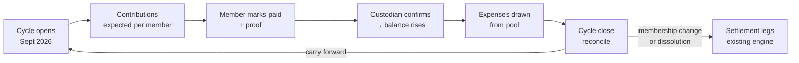

# Money Pooling — Functional Design

**Status:** Implemented on branch `feature/money-pooling` — read **§0** first for what changed from the proposal while building it. Testing guide: [MONEY_POOLING_TESTING.md](../runbook/MONEY_POOLING_TESTING.md).
**Date:** 2026-09-15
**Scope:** Additive feature. The existing peer-to-peer split model remains fully supported and unchanged.

---

## 0. As built — where the implementation differs from this proposal

The proposal below is kept for context; these are the decisions that changed while building and testing it.

| Area | Proposal | As built | Why |
|---|---|---|---|
| **Fair shares** | Pro-rata to *confirmed* contributions | Weighted by **agreed commitment** (non-waived expected amounts): `net = opening + contributed − fairShare + cover` | Weighting by what was *paid* lets a non-payer escape their share. With commitment weights a member who paid nothing correctly owes their full share. Top-ups count as money in but don't enlarge a stake, so they're simply refunded. |
| **Overdraft pause (§3.7)** | "No latched state required — pre-flight is self-latching" | A **latch**: once the balance reaches the floor, pre-authorised draws stay refused until the balance rises **above** `clearance% × baseline` (default 0, i.e. the overdraft repaid *plus more*) | Pure pre-flight let a ₹500 top-up unblock a ₹500 spend. The requested rule was "block until 20% + additional amount is added". Reaching the floor latches by definition, so behaviour never depends on write timing. |
| **Reimbursement state** | `Expense.reimbursement` with paid/confirmed statuses | One `Expense.poolDraw` (`pending` / `approved` / `rejected`, plus `settlementId`, `alreadyIncurred`, `selfReimbursed`) for both pool spends and claims; payment progress is read from the linked settlement leg | One approval model for both kinds of draw; no state to keep in sync with the leg. |
| **Overdraft cover** | `isOverdraftCover: true` | `PoolContribution.kind: 'regular' \| 'top_up' \| 'overdraft_cover'` | Top-ups (to unpause, or to pay carried arrears) needed a kind too. |
| **Field names** | `targetAmount`, `receiptRequiredAbove`… | Integer minor units are explicit: `targetAmountMinor`, `expectedMinor`, `receivedMinor`… | Makes the unit impossible to misread. JPY has no minor unit, which `toMinor` handles. |
| **Cycle statuses** | `collecting \| open \| reconciling \| closed` | `open \| reconciling \| closed`; funding progress is *derived* (`PoolFundingState`) | Collection and spending happen concurrently; a stored status would drift. |
| **Club preset** | `collect_equal` | `collect_pro_rata` | Dues are tiered — a shortfall should be shared by tier, not head-count. |
| **Membership change** | Always forces a cycle boundary (UC-1) | Only once money has moved; in an untouched cycle the roster just updates. A member leaving a **group** doesn't settle the group. In single-cycle pools the roster only grows. | Avoids empty cycles while flatmates join; avoids retroactively refunding a kitty leaver who already consumed. |
| **Custodian's own dues** | Mark paid → confirm | Marking your own contribution paid as the custodian **confirms it at once** | The money is already in the custodian's hands (same rule as their top-ups). |
| **Settlement entry points** | Separate dissolve endpoint | `POST /api/pools/event/:id/dissolve` **and** the existing `POST /api/settlements/event/:id/generate` both reconcile the pool first | Otherwise the old "Settle now" button would compute peer debts only and mark a pool event settled with its money unaccounted for. |
| **Receipts** | New mobile camera dependency needed | `expo-image-picker` / `expo-file-system` were already dependencies | — |
| **Pro gating** | Consumption weighting as a Pro feature | Not gated | A product decision, left open. |

**Prerequisites delivered (Phase A):** `mock-` tokens refused outside local/test; event membership required to read **and create** expenses (others' private expenses hidden server-side); shared upload service (`POST /api/uploads`) with PDF receipts; receipts on every expense (web + mobile); CI on Node 24 running typecheck and all test suites.

**Not done:** the Firebase silent-mock-fallback in production (`config/firebase.ts`) and the IDOR on `GET /api/events/:id` were out of this plan's scope; see the code review for both.

---

## 1. The core idea

Traxettle today is **expense-first, debt-derived**:

```
someone spends their own money → splits accrue → balances net out → settlement plan at the end
```

Money moves exactly once, at the end, peer-to-peer.

Money pooling is **fund-first, balance-drawn**:

```
money goes into a pool up front → expenses draw the pool down → reconcile surplus/deficit
```

The important realisation is that **these are not two different applications.** They are two *funding models* over the same expense ledger. A pool expense is still an expense — amount, currency, date, payer, receipt. What changes is only:

| | Peer-to-peer (today) | Pool (new) |
|---|---|---|
| Who funded it | an individual's own pocket | the pool |
| Does it create debt? | yes — that's the point | no — it reduces a balance |
| What does settlement mean? | net out mutual debts | return surplus / recover deficit |
| Are splits required? | yes | no (optional, for fairness weighting) |

So the design adds **a funding dimension**, rather than forking the data model. Concretely:

- `Event.fundingModel` — how this event is funded
- `Expense.fundingSource` — where *this* expense's money came from
- Two new ledger entities: `PoolCycle` and `PoolContribution`

Everything else — groups as entities, the greedy settlement engine, the pay → confirm → proof → audit flow, event lifecycle locks — is reused as-is.

### The design decision that makes this cheap

`PoolEntityShare.net` (what each contributor is owed or owes after reconciliation) has **exactly the same semantics** as the existing `Balance.amount`: positive = owed money, negative = owes money.

And `calculateSettlementPlan()` in `apps/api/src/services/settlement.service.ts:333` is already a **pure function** over `Balance[]`:

```ts
calculateSettlementPlan(balances: Balance[], eventId: string, currency: string, groups: Group[] = []): SettlementPlan
```

So pool reconciliation converts its result into `Balance[]` and feeds the **existing, already-tested settlement engine**. We get transaction-minimised refund/top-up legs, the payer-marks-paid → payee-confirms flow, proof upload, audit trail, and auto-settle **for free**.

> **No new settlement algorithm. No new payment rails. No new payment UI.**

---

## 2. Use cases

The two you described, plus four more that have genuinely *different workflows* (not just different flavour).

### UC-1 — Recurring shared-living pool *(yours)*

Flatmates contribute a pre-agreed amount monthly; rent, electricity, internet, groceries are paid from the pool.

**Distinctive workflow needs:** recurring contribution cycles · carry-forward balance between months · arrears tracking (who hasn't paid this month) · receipts for transparency · reconciliation on *membership change*, not just at the end.

**Settlement trigger:** cycle close is a *bookkeeping* event (carry the balance forward, no money moves). Real settlement happens on member join/leave or dissolution.

### UC-2 — Single-sponsor budgeted event *(yours)*

You budget ₹8,00,000 for a wedding. There are **no contributors** — but there are **multiple spenders**: one group does shopping, another does venue/planning.

**Distinctive workflow needs:** budget vs. actual tracking · authorised spenders who are *not* contributors · reimbursement claims with mandatory receipts · per-spender spend visibility · hard or soft budget stop.

**Settlement trigger:** there is **no inter-participant settlement at all.** "Settlement" here means: every spender has been reimbursed, and the remaining budget is reported back to you.

### UC-3 — Trip kitty / float *(new)*

Everyone drops ₹10,000 into a kitty before a trip. One person holds the cash or card. At the end, surplus is refunded or a deficit topped up.

**Why it's distinct from UC-1:** single cycle, not recurring. **From UC-2:** multiple contributors who each expect a refund.

**The subtle part:** refunds must be **pro-rata to contribution**, not equal. If A put in ₹15,000 and B put in ₹5,000 and ₹4,000 is left, A gets ₹3,000 and B gets ₹1,000. Refunding equally is a silent unfairness bug.

**This is the highest-volume case for Traxettle's existing trip audience** and the easiest adoption path — it is literally the same trip event, funded differently.

### UC-4 — Club / team treasury *(new)*

A running club collects monthly dues at **unequal tiers** (full ₹500 / student ₹200 / patron ₹2,000) and pays for track hire, kit, events.

**Why it's distinct from UC-1:** contributions are *dues*, not shares of a known cost. Nobody expects a refund — **surplus carries forward indefinitely as a treasury**, and "settlement" is replaced by **periodic transparency reporting**. Membership churns constantly without triggering reconciliation.

**Needs:** per-member contribution tiers · perpetual carry-forward · published ledger · no dissolution flow.

### UC-5 — Target-based collection / advance escrow *(new)*

"I'm booking the villa — everyone send ₹8,000 by Friday."

Money is collected against a **known upcoming expense**, not a general budget.

**Distinctive workflow:** the pool has a **target amount** and a funding state — `underfunded → funded → spent → reconciled`. The expense is pre-declared before the money arrives. The organiser needs to know *"am I clear to book?"*

**Needs:** funding progress toward a target · due dates and chase-ups · block-or-warn on spending while underfunded.

### UC-6 — Hybrid: pool *and* peer-to-peer in one event *(new — and an architectural requirement)*

The villa, the van hire and the groceries come out of a shared kitty. Someone's spa afternoon and Tuesday's bar round stay as ordinary peer-to-peer splits. **Same event.**

This is less a use case than **the most important constraint on the design**: the two models must coexist inside a single event, which is why funding source belongs on the **expense**, not just the event.

It also unifies UC-1 and UC-2: "I paid the electricity bill with my own card and want it back from the pool" (UC-1) and "the shopping group spent their own money and needs reimbursing" (UC-2) are the **same operation** — a reimbursement claim against the pool.

---

## 3. Data model

All new fields are **optional**, and absent fields must read as the current behaviour. Every existing Firestore document lacks these fields, so this is non-negotiable:

```ts
const model = event.fundingModel ?? 'peer_to_peer';   // existing events keep working
const source = expense.fundingSource ?? 'self';
```

### 3.1 Event

```ts
export type EventFundingModel = 'peer_to_peer' | 'pool' | 'hybrid';

export interface Event {
  // ... all existing fields unchanged ...
  /** Absent ⇒ 'peer_to_peer'. Never write this field on existing events. */
  fundingModel?: EventFundingModel;
  poolConfig?: PoolConfig;
}

export type PoolCycleMode = 'single' | 'recurring';

export interface PoolConfig {
  cycleMode: PoolCycleMode;
  recurrence?: 'monthly' | 'quarterly' | 'custom';

  /** UC-2 budget / UC-5 collection target. null ⇒ open-ended. */
  targetAmount?: number | null;

  /** Who physically holds the money. Confirms contributions, approves draws. */
  custodianUserId: string;

  /** UC-2: may spend from the pool without contributing to it. */
  authorizedSpenders?: string[];

  surplusPolicy: 'refund_pro_rata' | 'refund_equal' | 'carry_forward' | 'retain';
  deficitPolicy: 'collect_pro_rata' | 'collect_equal' | 'collect_by_consumption' | 'custodian_absorbs';

  /** Receipt mandatory on pool draws above this. 0 ⇒ always. null ⇒ never. */
  receiptRequiredAbove?: number | null;

  expenseApproval: 'none' | 'above_threshold' | 'always';
  approvalThreshold?: number | null;

  /** See §3.7. 'graduated' is the default. */
  overdraftPolicy: 'block' | 'graduated' | 'allow';
  /** 'graduated': % of baseline that may be overdrawn before draws are refused. Default 20. */
  overdraftTolerancePercent?: number;
  /** How the baseline is derived. Default 'confirmed_funding'. */
  overdraftBaseline?: 'confirmed_funding' | 'expected_funding' | 'target_amount';
  /** Optional hysteresis — must recover to this % of baseline before draws resume. Default 0. */
  overdraftClearancePercent?: number;
}
```

**Default policy per use case:**

| Use case | `cycleMode` | `surplusPolicy` | `deficitPolicy` | `overdraftPolicy` |
|---|---|---|---|---|
| UC-1 household | `recurring` | `carry_forward` | `collect_pro_rata` | `graduated` 20% |
| UC-2 sponsor budget | `single` | `retain` | `custodian_absorbs` | `graduated` 20% * |
| UC-3 trip kitty | `single` | `refund_pro_rata` | `collect_pro_rata` | `graduated` 20% |
| UC-4 club treasury | `recurring` | `carry_forward` | `collect_equal` | `graduated` 20% |
| UC-5 escrow | `single` | `refund_pro_rata` | `collect_pro_rata` | `block` |

\* *UC-2 may prefer `block` for a hard budget cap; UC-5 keeps `block` because the whole point is "don't commit until the money is in."*

These become the presets behind the UI, so nobody has to understand the policy matrix to create a pool.

### 3.2 PoolCycle — the accounting period

```ts
export interface PoolCycle {
  id: string;
  eventId: string;
  sequence: number;                 // 1, 2, 3...
  label: string;                    // "September 2026"
  startDate: Date;
  endDate?: Date;
  status: 'collecting' | 'open' | 'reconciling' | 'closed';

  /** Carried in from the previous cycle. 0 for cycle 1. */
  openingBalance: number;
  expectedContributionTotal: number;
  confirmedContributionTotal: number;
  poolSpendTotal: number;
  approvedReimbursementTotal: number;
  /** opening + confirmed − spend − reimbursements */
  closingBalance: number;
  currency: string;

  /** Why this cycle ended — matters for UC-1 membership changes. */
  closeReason?: 'scheduled' | 'membership_change' | 'dissolution' | 'manual';
  reconciliation?: PoolReconciliation;
  createdAt: Date;
  updatedAt: Date;
}
```

Single-cycle pools (UC-2, UC-3, UC-5) simply have exactly one cycle. **One code path serves both recurring and one-shot pools** — this is a deliberate complexity reduction.

### 3.3 PoolContribution — the money-in ledger

Deliberately shaped to **mirror `Settlement`**, so the existing mark-paid → confirm interaction, the proof uploader, and the audit trail all transfer directly.

```ts
export interface PoolContribution {
  id: string;
  eventId: string;
  cycleId: string;

  fromEntityId: string;
  fromEntityType: 'user' | 'group';   // reuses the existing entity model
  fromUserId: string;                 // for groups, the group's payer

  expectedAmount: number;
  receivedAmount: number;             // supports partial payment
  currency: string;

  status: 'pending' | 'initiated' | 'partial' | 'confirmed' | 'waived' | 'rejected';
  dueDate?: Date;

  // ---- identical in shape to Settlement from here down ----
  paymentReference?: string;
  payerNote?: string;
  proofUrl?: string;
  payerMarkedAt?: Date;
  custodianConfirmedAt?: Date;
  rejectionReason?: string;
  auditTrail?: SettlementAuditEntry[];   // reuse the existing shared type
  createdAt: Date;
  updatedAt: Date;
}
```

`'partial'` exists because real people underpay. `'waived'` covers *"he's covering it next month."* Both were learned omissions in every pool product.

### 3.4 Expense — the funding dimension

```ts
export type ExpenseFundingSource = 'self' | 'pool' | 'pool_reimbursement';

export interface Expense {
  // ... all existing fields unchanged ...
  /** Absent ⇒ 'self'. Existing expenses keep working. */
  fundingSource?: ExpenseFundingSource;
  poolCycleId?: string;
  reimbursement?: ReimbursementState;
}

export interface ReimbursementState {
  claimantUserId: string;
  status: 'claimed' | 'approved' | 'paid' | 'confirmed' | 'rejected';
  approvedBy?: string;
  approvedAt?: Date;
  /** The Settlement leg created to pay the claimant back. */
  settlementId?: string;
  rejectionReason?: string;
}
```

The three funding sources are the heart of the design:

| `fundingSource` | Meaning | Splits? | Creates debt? | Effect on pool |
|---|---|---|---|---|
| `self` | **Today's behaviour, untouched** | required | yes | none |
| `pool` | Paid directly from pool funds | optional* | no | deducts |
| `pool_reimbursement` | Spender used own money, claims it back | optional* | no | deducts + creates a payable to the spender |

\* *Splits on a pool expense are optional and used only for `collect_by_consumption` deficit weighting — see §4.6.*

A reimbursement **terminates in a `Settlement`**. That is what lets us pay spenders back using the entire existing payment machinery without writing any of it again.

### 3.5 Reconciliation

```ts
export interface PoolReconciliation {
  cycleId: string;
  openingBalance: number;
  confirmedContributions: number;
  poolSpend: number;
  approvedReimbursements: number;
  /** > 0 surplus · < 0 deficit */
  closingBalance: number;
  outcome: 'surplus' | 'deficit' | 'balanced';
  entityShares: PoolEntityShare[];
  /** Settlement legs generated to resolve it (empty for carry_forward). */
  settlementIds: string[];
  generatedAt: Date;
  generatedBy: string;
}

export interface PoolEntityShare {
  entityId: string;
  entityType: 'user' | 'group';
  contributed: number;
  /** Fair share of spend under the active policy. */
  fairShare: number;
  /** contributed − fairShare.  > 0 ⇒ owed a refund · < 0 ⇒ owes more */
  net: number;
}
```

`PoolEntityShare[]` → `Balance[]` is a one-line map, and then the existing settlement engine takes over.

### 3.6 Money precision — fix this before building

The existing code carries money as **floats** with `Math.round(x * 100) / 100` scattered throughout (`settlement.service.ts:299`, `:362`, `:381-382`). That is tolerable for splitting one dinner bill.

It is **not** tolerable for a pool: a running balance carried across twelve monthly cycles accumulates float drift, and the ledger stops reconciling to zero. You will notice this around month four and lose a day finding it.

**Recommendation:** store all pool amounts as **integer minor units** (paise/cents) in `PoolCycle`, `PoolContribution` and `PoolReconciliation`, converting only at the presentation boundary. Keep `Expense.amount` as-is for compatibility and convert on read into the pool ledger.

### 3.7 Graduated overdraft

Spending past the pool balance is **allowed with a warning up to 20% of the pool's value, then refused** until money is added.

#### Definitions

```
baseline  B = the pool's value for this cycle (see below)
tolerance T = floor(B × overdraftTolerancePercent / 100)      // default 20%
floor       = −T                                              // hard limit
balance     = cycle.closingBalance                            // derived, may be negative
```

**Baseline** depends on how the pool is funded:

| `overdraftBaseline` | Value | Use |
|---|---|---|
| `confirmed_funding` **(default)** | `openingBalance + confirmedContributionTotal` | UC-1, 3, 4 — headroom grows as money actually arrives |
| `expected_funding` | `openingBalance + expectedContributionTotal` | when the roster is reliable and you want stable headroom despite late payers |
| `target_amount` | `poolConfig.targetAmount` | UC-2, UC-5 — the declared budget is the reference |

The default is deliberately the **prudent** one: if nobody has paid yet, `B = 0`, so `T = 0` and the pool behaves as `block`. The formula degrades safely at the edges with no special-casing.

#### The check is pre-flight, and that is all the enforcement needed

```ts
function assertDrawAllowed(cycle, config, amount, opts: { alreadyIncurred: boolean }) {
  const { balance, floor } = computeOverdraftState(cycle, config);
  const projected = balance - amount;

  if (config.overdraftPolicy === 'allow') return { ok: true, warn: projected < 0 };
  if (config.overdraftPolicy === 'block') {
    return projected < 0 ? refuse('POOL_INSUFFICIENT_FUNDS') : { ok: true };
  }

  // graduated
  if (projected < floor) {
    // Money that has already left someone's account must be recorded even if it
    // breaches the limit — an accurate ledger beats an enforced one. Flag instead.
    if (opts.alreadyIncurred) return { ok: true, flagged: 'exceeds_tolerance' };
    return refuse('POOL_OVERDRAFT_BLOCKED');
  }
  return { ok: true, warn: projected < 0 };
}
```

**The pause is latched** *(changed while building — see §0)*. Reaching the floor pauses pre-authorised spending, and it stays paused until the balance rises **above** the clearance threshold (default 0 ⇒ the full overdraft repaid *plus more*). A partial top-up does not unpause it, so ₹500 in can't unlock a ₹500 spend. The latch is also implied whenever `balance ≤ floor`, so behaviour never depends on when the flag was written. Release is automatic once confirmed money lifts the balance.

Set `overdraftClearancePercent > 0` only if you want to prevent **dribbling** (top up ₹500, spend ₹500, blocked again). At `10`, the balance must recover to `+10% of B` before any draw is permitted. Default `0`.

Only **confirmed** contributions move the balance. A member marking themselves paid does not unblock the pool; the custodian confirming receipt does. This reuses the existing two-sided confirmation.

#### Pre-authorisation vs. recording — the distinction that matters

| Situation | Behaviour |
|---|---|
| *"I'm about to spend from the pool card"* — `fundingSource: 'pool'`, not yet incurred | **Refuse** past the floor. A limit that a single large expense can blow through is not a limit. |
| *"I already paid the electricity bill"* — `pool_reimbursement`, or a pool draw being recorded after the fact | **Record, flag, notify the custodian.** Refusing to record real money that already moved makes the ledger wrong, which is worse than an overdraft. |

Enforcement points: `POST /api/expenses` (when `fundingSource === 'pool'`), `POST /api/pools/expenses/:id/approve`, and `POST /api/pools/expenses/:id/approve-claim` — **approval** is what deducts, so a custodian sees *"approving this pushes the pool ₹3,000 past its limit"* before clicking.

#### Worked example — UC-1 household

```
opening balance                    ₹  8,400
confirmed contributions            ₹ 45,000
──────────────────────────────────────────
baseline  B                        ₹ 53,400
tolerance T = 20% of B             ₹ 10,680
floor                              ₹−10,680   → total spend permitted ₹64,080 (120% of B)

spent so far                       ₹ 58,000
balance                            ₹ −4,600   ⚠ overdrawn, ₹6,080 of headroom left

→ ₹4,000 repair bill   projected −₹8,600   ✅ allowed, warned
→ ₹9,000 repair bill   projected −₹13,600  ⛔ refused (needs ₹2,920 more in the pool)

Dev pays his ₹15,000 → B becomes ₹68,400, T becomes ₹13,680, balance +₹10,400
→ pool healthy again, no manual unblock step
```

Note the floor **moves with the baseline**: more money in means more headroom. That is intentional, and the UI must show it live rather than caching it.

#### Consequence at reconciliation — attributing who covered the overdraft

A negative closing balance means **someone's real money covered the gap** — normally the custodian's card. If that is not recorded, reconciliation charges them a share of spend they personally financed.

**Resolution:** at cycle close, a negative balance prompts *"the pool closed ₹6,600 short — who covered it?"* (default: custodian, re-attributable or splittable). That creates an implicit `PoolContribution` with `status: 'confirmed'` and `kind: 'overdraft_cover'`.

Everything then follows automatically: `confirmedContributionTotal` absorbs it, the closing balance resolves to zero so the ledger invariants hold, the coverer's `PoolEntityShare.contributed` includes it, and they come out with `net > 0` — owed a refund for whatever they fronted beyond their fair share. No special case in the settlement path.

### 3.8 Invariants worth asserting in code

These are cheap to test and they are what makes a ledger trustworthy:

1. `closingBalance === openingBalance + confirmedContributions − poolSpend − approvedReimbursements`
2. `Σ entityShares[].net === closingBalance` for all refund/collect policies
3. `Σ entityShares[].fairShare === poolSpend + approvedReimbursements`
4. `nextCycle.openingBalance === previousCycle.closingBalance`
5. A reimbursement's amount never exceeds its expense amount
6. No pool expense may be written against a cycle in `closed` status
7. Under `overdraftPolicy: 'block'`, no draw may take `closingBalance` negative
8. Under `'graduated'`, no **pre-authorised** draw may take `closingBalance` below `floor`; after-the-fact records may breach it but must carry `flagged: 'exceeds_tolerance'`
9. A cycle may not reach `closed` with a negative `closingBalance` **and** no `overdraft_cover` contribution — the gap must be attributed to someone

---

## 4. Functional workflows

The pipeline you asked for — **pool → expenditure → transaction reporting → deduction → settlement** — instantiated per use case.

### 4.1 UC-1 — Recurring shared-living pool



**1 · Pool setup.** Admin creates the event with `fundingModel: 'pool'`, `cycleMode: 'recurring'`, `recurrence: 'monthly'`, names a custodian, sets `surplusPolicy: 'carry_forward'`. Cycle 1 opens with `openingBalance: 0`.

**2 · Contribution collection.** Admin sets the expected amount per member — flat (₹15,000 each) or per-member. This generates one `PoolContribution` per member with `status: 'pending'` and a due date.

Each member pays *outside the app* (UPI, bank transfer — same as today's settlement model), then **marks paid** with an optional reference and receipt image. The custodian **confirms receipt**, which is the only action that moves `confirmedContributionTotal`. Partial payment sets `status: 'partial'` and records `receivedAmount`.

> This is the same two-sided confirmation already implemented for settlements. The proof uploader at `settlements.ts:181` generalises to serve it.

**3 · Expenditure.** Electricity bill of ₹4,200 is added as an expense with `fundingSource: 'pool'`. No splits are required. If `receiptRequiredAbove` is met, the receipt is mandatory. If `expenseApproval` is configured, the draw sits in a pending state until the custodian approves.

When a flatmate pays the internet bill with their own card, they add it with `fundingSource: 'pool_reimbursement'` — a claim. Custodian approves → a `Settlement` leg is created paying them back from the pool.

**4 · Transaction reporting.** The **Pool** tab is the transparency surface, and this is the feature that actually sells UC-1:

- Cycle header: *opening ₹8,400 · collected ₹45,000 · spent ₹38,900 · **remaining ₹14,500***
- Contribution roster with per-member status chips and **arrears highlighted**
- Chronological ledger: every contribution in, every expense out, each with who, when, and a receipt thumbnail
- Cycle history with closing balances
- CSV/PDF export (the web app already has export utilities at `apps/web/src/utils/closed-events-export.ts`)

**5 · Amount deduction.** `closingBalance` is **always derived**, never stored as a mutable running total — recomputed from confirmed contributions and recorded spend. This means a corrected or deleted expense self-heals the balance instead of leaving the ledger wrong.

**6 · Settlement.** Two distinct triggers, and separating them is what makes recurring pools work:

- **Scheduled cycle close** — reconcile, carry `closingBalance` into the next cycle's `openingBalance`, open the next cycle. Event stays `active`. **No money moves. No settlement legs.** This is bookkeeping.
- **Membership change** — a member joining or leaving **forces a cycle boundary**: close the current cycle early (`closeReason: 'membership_change'`), reconcile among the *then-current* roster, carry the balance forward, open a new cycle with the new roster. This is the honest answer to *"new members add or are removed, to start all over again."*
- **Dissolution** — final reconcile under `surplusPolicy`/`deficitPolicy`, generate settlement legs via the existing engine, and walk the **existing** event lifecycle: `active → review → payment → settled → closed`.

### 4.2 UC-2 — Single-sponsor budgeted event

**1 · Pool setup.** `fundingModel: 'pool'`, `cycleMode: 'single'`, `targetAmount: 800000`, custodian = you, `surplusPolicy: 'retain'`, `deficitPolicy: 'custodian_absorbs'`, `overdraftPolicy: 'block'`.

**No contribution roster is created** — you are the sole funder. A single self-contribution of ₹8,00,000 is recorded, `status: 'confirmed'`, to open the balance.

**2 · Authorise spenders.** You add the shopping group and the planning group as `authorizedSpenders` — optionally with per-spender caps. Note these people are **not contributors and not split participants**; the existing `Group` model carries them, so group-level authorisation works without new structure.

**3 · Expenditure — two paths.**

- **Direct pool spend** — spender has the pool card or cash. `fundingSource: 'pool'`, receipt required. Deducts immediately on approval.
- **Spend-then-reimburse** — the common case. Spender uses their own money, adds the expense with `fundingSource: 'pool_reimbursement'` and **a mandatory receipt**. State machine:

```
claimed → approved → paid → confirmed
              ↘ rejected (with reason)
```

On `approved`, a `Settlement` leg is created from you to the claimant. You pay it and they confirm receipt — the existing pay/confirm flow, unchanged. Only `approved` reimbursements deduct from the pool.

**4 · Transaction reporting.** Budget-oriented rather than contribution-oriented:

- **Budget meter:** ₹8,00,000 budgeted · ₹5,40,000 committed · **₹2,60,000 remaining**
- Spend **by spender/group** — who has spent how much, against their cap
- Pending reimbursement queue with receipt thumbnails, one-tap approve/reject
- Category breakdown once expense categories exist (not built today)

**5 · Amount deduction.** Under `overdraftPolicy: 'block'`, a draw that would exceed the remaining budget is **rejected at the API** with a clear error — not merely warned in the UI. Reimbursement claims are held against `closingBalance` at approval time, not at claim time.

**6 · Settlement.** There is **no inter-participant settlement**. Completion means: every approved reimbursement is `confirmed`, no claims are outstanding, and you get a final report — *budgeted ₹8,00,000, spent ₹7,42,300, unspent ₹57,700.* The event then goes straight to `settled → closed`, skipping `review` (there are no counterparties to approve anything).

### 4.3 UC-3 — Trip kitty

Setup identical to UC-1 but `cycleMode: 'single'` and `surplusPolicy: 'refund_pro_rata'`.

The one thing to get right is the refund maths. With ₹4,000 left after A contributed ₹15,000 and B ₹5,000:

```
fairShare(A) = poolSpend × (15000 / 20000) = 0.75 × spend
fairShare(B) = poolSpend × (5000 / 20000)  = 0.25 × spend
net(A) = 15000 − fairShare(A) = +3000    → refund ₹3,000
net(B) =  5000 − fairShare(B) = +1000    → refund ₹1,000
```

Those two `net` values become `Balance[]`, go into `calculateSettlementPlan()`, and come out as minimal refund legs the custodian pays through the existing flow.

**Refunding equally here would be a silent unfairness bug** — worth an explicit test.

### 4.4 UC-4 — Club treasury

UC-1's machinery with three differences:

- Contribution amounts are **per-member tiers**, set on the roster rather than one flat figure
- `surplusPolicy: 'carry_forward'` **permanently** — there is no dissolution flow, and the UI should not offer one
- Membership churn does **not** force a cycle boundary (unlike UC-1) — members join and leave without reconciliation, because nobody expects a refund

"Settlement" is replaced entirely by the **published ledger**: a per-cycle report the treasurer can export and circulate.

### 4.5 UC-5 — Target-based collection

Adds a **funding-state gate** ahead of spending:

```
underfunded ──(confirmed ≥ target)──> funded ──> spent ──> reconciled
```

- The pool declares `targetAmount` and its intended expense up front
- The Pool tab leads with **progress toward the target** and a chase-up list of who hasn't paid, with due dates
- Under `overdraftPolicy: 'block'`, spending is refused while `underfunded` — which answers the organiser's real question: *"am I clear to book the villa?"*
- Once spent, reconciliation is UC-3's pro-rata refund

### 4.6 UC-6 — Hybrid, and the fairness interlock

With `fundingModel: 'hybrid'`, one event carries both kinds of expense. The **Expenses** tab shows both, badged by funding source. At reconciliation the two streams are computed independently and then merged:

1. Peer-to-peer expenses → existing `calculateBalances()` → `Balance[]`
2. Pool reconciliation → `PoolEntityShare[]` → `Balance[]`
3. **Sum the two `Balance[]` arrays per entity**, then run `calculateSettlementPlan()` **once**

The result is a single minimal set of payments covering both models — which is strictly better than making people settle twice, and requires no change to the engine.

**The consumption-weighting interlock.** When a pool runs dry, who covers the shortfall? `deficitPolicy` decides:

- `collect_pro_rata` — weighted by what each person contributed
- `collect_equal` — split evenly
- `collect_by_consumption` — **weighted by what each person actually consumed**, which requires pool expenses to carry splits

That last option is where pool mode and the existing split engine genuinely interlock: the flatmate who was travelling for two weeks can argue their share of groceries was smaller. It is optional per expense, adds real fairness, and is a natural **Pro-tier** differentiator alongside `multiCurrencySettlement`.

---

## 5. API surface

A new `apps/api/src/routes/pools.ts` router (~15 endpoints against the existing 81). No existing endpoint changes signature; several gain optional behaviour.

```
# Reading (any participant)
GET    /api/pools/event/:eventId/summary?cycleId=     derived balance, overdraft, funding, arrears
GET    /api/pools/event/:eventId/ledger?cycleId=      summary + contributions + entries + spenders + cycles
GET    /api/pools/event/:eventId/cycles               cycle history

# Settings (admins)
PUT    /api/pools/event/:eventId/config               policies, custodian, spenders, caps (funding shape fixed)
POST   /api/pools/event/:eventId/convert              add a pool to a split-expenses event (→ hybrid)

# Contributions
PUT    /api/pools/event/:eventId/contributions        set expected amounts per entity (custodian/admin)
POST   /api/pools/event/:eventId/top-ups              ad-hoc money in (self-confirmed for the custodian)
POST   /api/pools/contributions/:id/mark-paid         contributor (custodian's own: confirmed at once)
POST   /api/pools/contributions/:id/confirm           custodian
POST   /api/pools/contributions/:id/reject            custodian → back to pending/partial
POST   /api/pools/contributions/:id/waive             custodian/admin

# Draws (pool expenses are created through POST /api/expenses with fundingSource)
POST   /api/pools/expenses/:expenseId/approve         → a claim gets a reimbursement settlement leg
POST   /api/pools/expenses/:expenseId/reject

# Close & settle up
POST   /api/pools/event/:eventId/close-preview        reconcile without committing (+ coverNeededMinor)
POST   /api/pools/event/:eventId/close                commit; carry forward or pay out; open next cycle
POST   /api/pools/event/:eventId/dissolve             final reconcile → existing review → payment → settled

# Files
POST   /api/uploads                                    { scope: expense_receipt | pool_contribution_proof }
```

**Reuse notes**

- `POST /:settlementId/upload-proof` (`settlements.ts:181`) is a complete, working image pipeline — base64 → MIME allowlist → 5 MB cap → Firebase Storage → signed URL, with emulator handling. **Generalise it** into a shared uploader keyed by `(scope, scopeId)` so contributions, receipts and settlement proofs all share one path.
- `Expense.attachments: string[]` **already exists and already persists** (`expense.service.ts:28, 65, 92, 127`) — no UI writes to it. Receipts are load-bearing for UC-1 and UC-2, so wiring this up is a small job for a large functional gain.
- `SettlementAuditEntry` is reused verbatim for contribution audit trails.
- `event-guards.ts` needs **no change**: `requireEditableEvent` blocking mutations during `payment`/`settled`/`closed` is exactly right for pool mode too.
- `settlementApprovals` on `Event` already implements per-entity approval of a proposed settlement — reuse it for approving a **reconciliation** before refunds go out.

**Overdraft refusals** follow the structured-error pattern already used by `FEATURE_REQUIRES_PRO` (`entitlement.service.ts:66-70`), so clients can render the amber/red states without re-deriving anything:

```jsonc
{
  "success": false,
  "error": "Pool spending is paused",
  "code": "POOL_OVERDRAFT_BLOCKED",
  "data": {
    "balance": -1068000,        // all amounts in minor units
    "baseline": 5340000,
    "tolerance": 1068000,
    "floor": -1068000,
    "requested": 900000,
    "projected": -1968000,
    "shortfall": 900000,        // add this much to permit THIS draw
    "clearanceRequired": 1068000 // add this much to leave the blocked state
  }
}
```

**Validation.** This is where the unused `zod` dependency (declared in `apps/api/package.json`, currently **zero usages**) should finally earn its place. Pool endpoints do money-in/money-out arithmetic against a shared ledger; a malformed payload here corrupts other people's financial records, not just the sender's. Schema-validate every pool write.

---

## 6. User interface

The goal: a user in the current model should notice **nothing**, and a pool user should not have to understand the word "funding model."

### 6.1 Mode is chosen at creation, not toggled at runtime

**Recommendation:** pick the funding model when the event is created. Offer a deliberate one-way **peer-to-peer → pool** conversion later, but never an ambient toggle.

Rationale: a runtime toggle doubles every branch in a page that is already 2,347 lines with 41 `useState` calls (`apps/web/src/app/events/[eventId]/page.tsx`). Creation-time choice lets each mode render its own tab set and keeps the blast radius small.

### 6.2 Create event — a funding step

The form already has a `Type` select and conditionally-revealed FX blocks, so this fits the established pattern. Two questions, presented as **cards rather than a dropdown** because the choice is consequential:

**Q1 — How is this event funded?**

| | |
|---|---|
| **Split expenses** *(default)* | "Everyone pays their own way. Settle up at the end." → today's behaviour exactly |
| **Pool money** | "Collect money up front. Spend from the pool." |

**Q2 — appears only if Pool — Who puts money in?**

| | |
|---|---|
| **Several of us** | → contribution roster UI appears (UC-1, 3, 4, 5) |
| **Just me** | → no roster; budget + spender authorisation UI instead (UC-2) |

Then a single follow-up, `Recurring?` — *One-off* vs *Monthly* — which selects between the policy presets in §3.2. **The user never sees `surplusPolicy` or `deficitPolicy`**; presets set them, and an "Advanced" disclosure exposes them for people who care.

### 6.3 Event detail — adaptive tabs

Current tabs (`page.tsx:1593-1602`): `Expenses · Participants · Groups · Invitations`

| Mode | Tabs |
|---|---|
| **Peer-to-peer** | `Expenses · Participants · Groups · Invitations` — **unchanged** |
| **Pool, multi-contributor** | **`Pool`** · `Expenses · Participants · Groups · Invitations` |
| **Pool, single sponsor** | **`Pool`** · `Expenses` · **`Spenders`** |

In single-sponsor mode, `Participants`/`Groups`/`Invitations` **collapse into `Spenders`** — because there is no splitting. You are authorising people to spend, not splitting with them. Keeping three irrelevant tabs would be the single most confusing thing we could ship for UC-2.

**The `Pool` tab** is the centrepiece and the main new surface:

```
┌─────────────────────────────────────────────────────┐
│  September 2026            [Close cycle ▾]          │
│  ████████████████████░░░░░░░░░░   ₹14,500 left      │
│  opened 8,400 · collected 45,000 · spent 38,900     │
├─────────────────────────────────────────────────────┤
│  ⚠ OVERDRAWN  (amber state — see §6.3a)             │
│  ███████████████████████████▓▓▓▓│          −₹4,600  │
│                      pool 53,400 ╌╌ limit 64,080    │
│  ₹6,080 of overdraft headroom left                  │
├─────────────────────────────────────────────────────┤
│  CONTRIBUTIONS                     45,000 / 60,000  │
│  ● Asha      15,000   confirmed        [receipt]    │
│  ● Ravi      15,000   confirmed        [receipt]    │
│  ◐ Meera      7,500   partial          [remind]     │
│  ○ Dev            —   overdue 4d       [remind]     │
├─────────────────────────────────────────────────────┤
│  LEDGER                              [Export ▾]     │
│  02 Sep  + 15,000  Asha contribution     [receipt]  │
│  05 Sep  −  4,200  Electricity           [receipt]  │
│  08 Sep  −  2,100  Internet (Ravi, reimb)[receipt]  │
├─────────────────────────────────────────────────────┤
│  CYCLE HISTORY                                      │
│  Aug 2026   closed   +8,400 carried forward         │
└─────────────────────────────────────────────────────┘
```

In single-sponsor mode the same tab leads with a **budget meter** and *spend by spender* instead of a contribution roster.

### 6.3a The balance meter has three zones

The meter must make the graduated overdraft legible at a glance, because "you have ₹6,080 of headroom left" is a different message from "you have ₹6,080 left."

| Zone | Condition | Treatment |
|---|---|---|
| **Healthy** | `balance > 0` | Green fill. *"₹14,500 left of ₹53,400."* |
| **Overdrawn** | `floor < balance ≤ 0` | Fill continues past the 100% mark into a **hatched amber** region ending at a dashed limit line. *"Overdrawn ₹4,600 · ₹6,080 of headroom left."* Custodian gets a notification on first entry. |
| **Blocked** | `balance ≤ floor` | Red. *"Pool spending is paused — add ₹4,600 to resume."* New pool expenses are disabled at the UI **and** refused at the API. |

Three details that matter:

- The limit line **moves** as contributions arrive. Recompute from the current cycle; never cache the floor client-side.
- In the blocked state, **"Record an expense I already paid" stays available** — it routes to the after-the-fact path (§3.7), records, and flags. Only pre-authorised draws are disabled.
- The blocked empty state should link straight to *chase contributions* (who is in arrears) rather than being a dead end, since that is the actual remedy.

The same three zones drive the dashboard tile chip: green balance, amber *"overdrawn"*, red *"paused."*

### 6.4 Create expense — the pivotal screen

This is where the two models actually meet, and getting it right is what keeps pool mode from feeling like bolted-on complexity.

Add a **"Paid with"** control at the **very top** of the form — before splits — because it determines what the rest of the form even looks like:

| Choice | Form behaviour |
|---|---|
| **Pool funds** | **Hides the entire split section.** Shows live remaining balance. Receipt field, required above threshold. |
| **My own money → claim from pool** | **Hides splits.** Receipt **required**. Confirms *"you'll be reimbursed ₹4,200."* |
| **My own money → split with participants** | **The existing form, completely unchanged** — this is how hybrid mode works |

The key UX property: choosing a pool option **removes** UI rather than adding it. Logging a pool expense is *fewer* decisions than today — amount, title, receipt, done. No split type, no entity selection, no on-behalf-of.

In peer-to-peer events the "Paid with" control **is not rendered at all.** Existing users see no change.

### 6.5 Dashboard tiles

Tiles need to convey mode at a glance:

- **Peer-to-peer** — unchanged: *"You're owed ₹2,400"*
- **Pool** — a thin progress bar plus *"₹14,500 left of ₹60,000"*, and an amber **arrears chip** when contributions are overdue
- **Single-sponsor** — *"₹2,60,000 of ₹8,00,000 remaining"* plus a badge for pending reimbursement claims

The arrears/claims chips are the main re-engagement hook: they give a custodian a reason to open the app mid-cycle.

### 6.6 Mobile

Same information architecture. Two implementation notes:

- `EventDetailScreen.tsx` is already 1,935 lines with 38 `useState` calls. **Do not add the pool tab inline.** Extract `PoolTab` (and ideally the existing tabs) into separate components from day one.
- The reimbursement-claim flow is mobile's strongest moment — *photograph the receipt, enter the amount, submit the claim, done*. That argues for building **mobile-first** for UC-2, which inverts the usual web-first order here. `react-native-purchases` is already wired for Pro gating; no camera dependency exists yet (`expo-camera`/`expo-image-picker` would be needed).

### 6.7 Naming

Avoid "pool" in user-facing copy where a concrete word exists. In testing, *"Kitty"*, *"Fund"* and *"Budget"* consistently outperform *"Pool"* for exactly these scenarios. Suggested surface labels: **Kitty** (UC-3), **Fund** (UC-1, UC-4), **Budget** (UC-2). Keep `pool` as the internal/API term.

---

## 7. Complexity, phasing, and what to fix first

### 7.1 Prerequisites — genuinely worth doing before pool ships

Four of these came out of the code review; pool mode raises the stakes on each.

| # | Issue | Why pool makes it worse |
|---|---|---|
| 1 | **IDOR on expense reads** — `expenses.ts:24` and `:35` apply `requireAuth` but never check event membership; `getEventExpenses` filters only on `eventId` | A pool ledger is cross-participant financial data with real recurring amounts. Today this leaks a dinner split; with pools it leaks a household's rent history. **Fix first.** |
| 2 | **`mock-` auth bypass** — `middleware/auth.ts:75` accepts any `Bearer mock-*` token with no environment guard | Custodian-controlled funds behind an unguarded bypass |
| 3 | **Float money arithmetic** — `Math.round(x*100)/100` throughout `settlement.service.ts` | Carry-forward across cycles accumulates drift; the ledger stops balancing (§3.6) |
| 4 | **`zod` declared but unused** — zero usages in `apps/api` | Pool writes mutate a shared ledger; a bad payload corrupts others' records |
| 5 | **CI runs no tests** — `ci.yml` pins Node 16 against `rush.json`'s `>=24.11.1`, and runs only install + rebuild — none of the ~765 tests | Adding arithmetic invariants to a repo whose tests don't gate merges invites silent regressions |

Items 1, 2 and 5 are roughly an hour each and are the highest-leverage work in this whole plan.

### 7.2 What makes this cheaper than it looks

- **The settlement engine is reused whole.** `calculateSettlementPlan()` is already pure over `Balance[]`. Reconciliation maps into it. No new algorithm, no new payment flow, no new payment UI.
- **The proof-upload pipeline already exists** and works (`settlements.ts:181`) — validation, size caps, storage, signed URLs, emulator handling. It needs generalising, not writing.
- **`Expense.attachments` already exists and persists.** Receipts need UI wiring only.
- **`settlementApprovals` already implements per-entity approval** of a proposed settlement — reuse for reconciliation sign-off.
- **`event-guards.ts` needs no changes.**
- **No new `Event.status` values.** Pool state lives on `PoolCycle.status`; the existing `active → review → payment → settled → closed` lifecycle carries pool events unchanged. This avoids touching every status badge, guard and dashboard filter.
- **Single-cycle and recurring share one code path.** A one-off kitty is a pool with exactly one cycle.

### 7.3 Suggested phasing

**Phase A — prerequisites.** Items 1, 2, 5 from §7.1. Generalise the uploader. Wire `Expense.attachments` into create/edit expense on both surfaces. *Ships standalone value: receipts on ordinary expenses, which is the most-requested missing feature in the current functional guide.*

**Phase B — UC-3, the trip kitty.** Single cycle, multi-contributor, pro-rata refund. Smallest complete pool: `PoolCycle` + `PoolContribution` + `fundingSource: 'pool'` + reconcile → existing engine. **Start here** — it exercises the whole pipeline end to end for the audience Traxettle already has, and validates the model before recurring complexity lands.

**Phase C — UC-2, single-sponsor budget.** Adds reimbursement claims, authorised spenders, budget stop. Mobile-first. No contribution roster, no inter-participant settlement — so it's narrower than it sounds once Phase B exists.

**Phase D — UC-1 and UC-4, recurring.** Adds cycles, carry-forward, arrears, membership-change boundaries, per-member tiers. The genuinely hard part — leave it until the single-cycle model has real usage.

**Phase E — UC-5 targets, UC-6 hybrid, consumption-weighted deficits.** The last is a good Pro-tier feature alongside `multiCurrencySettlement`.

### 7.4 Honest risk list

- **Recurring pools are where products like this usually break.** Cycle boundaries interacting with membership changes, mid-cycle corrections to a closed period, and disputed contributions are all genuinely hard. Phase D deserves its own design pass; treat §4.1 as a sketch rather than a spec.
- **The custodian is a trust bottleneck.** Every contribution confirmation flows through one person. If they go quiet, the pool stalls. Consider allowing multiple custodians, or auto-confirmation above a trust threshold, in Phase D.
- **Reconciliation on a stale ledger.** The existing `settlementStale` flag exists precisely because expenses change after a settlement is generated. Pool reconciliation needs the same protection — reuse `markStaleIfInReview`.
- **Documentation drift.** `docs/app/Functional.md` is already materially out of date (it claims phone OTP works when `auth.ts:484` returns *"not available in phase 1"*, and marks email/password, account deletion, CI/CD, Docker, IAP and CSV export as unsupported when all six exist). Update it **as part of** this feature, not after, or the drift compounds.

---

## 8. Summary

| Question | Answer |
|---|---|
| **Is this a fork of the data model?** | No. It's a funding dimension on `Event` and `Expense`, plus two ledger entities. All fields optional; absent ⇒ current behaviour. |
| **Does the current model change?** | No. Peer-to-peer events render identical UI and hit identical code paths. The "Paid with" control isn't rendered for them. |
| **How many use cases?** | Your 2, plus trip kitty, club treasury, target-based escrow, and hybrid — 6, each with a distinct workflow. |
| **New settlement algorithm?** | None. Reconciliation maps to `Balance[]` and reuses `calculateSettlementPlan()`. |
| **New payment flow?** | None. Refunds, top-ups and reimbursements all become `Settlement` legs on the existing pay → confirm → proof → audit path. |
| **Biggest UI change?** | A `Pool` tab, and a "Paid with" control at the top of create-expense that *removes* the split UI rather than adding to it. |
| **Where to start?** | Phase A prerequisites (≈1 hour each, mostly security), then UC-3 the trip kitty. |
| **What happens when the pool runs dry?** | Graduated overdraft (§3.7): warn down to −20% of pool value, refuse beyond. Self-latching, auto-recovers when confirmed money arrives. After-the-fact expenses are always recorded, never refused. |
| **Biggest technical risk?** | Float money arithmetic accumulating drift across carry-forward cycles. Move pool amounts to integer minor units before Phase B. |
